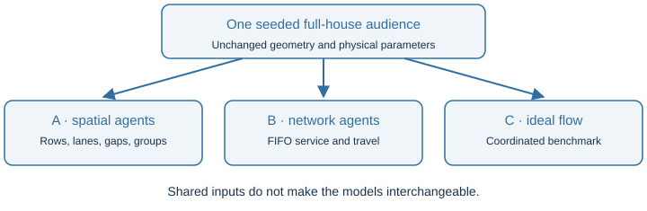
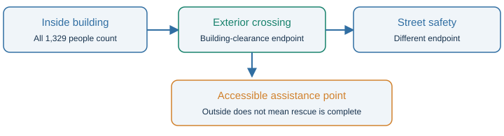
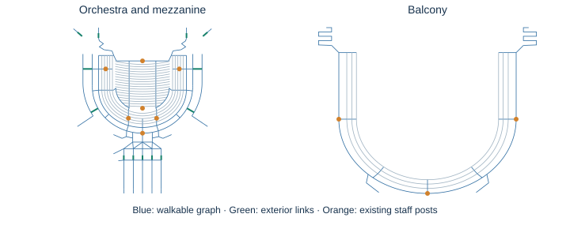
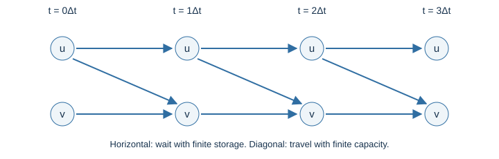
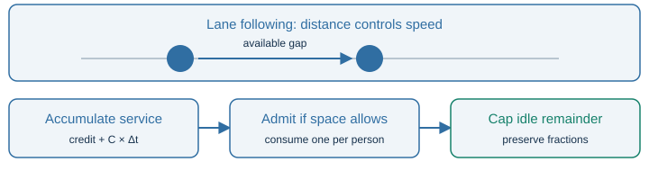
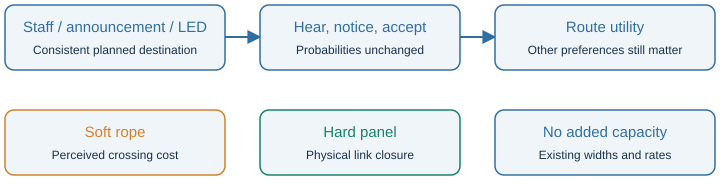
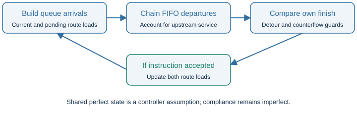
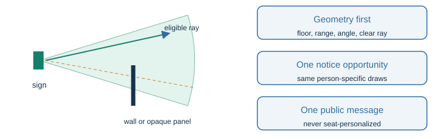
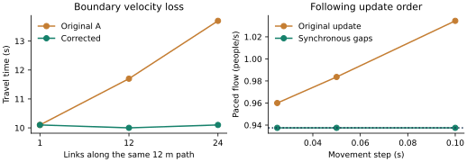

# Bailey Hall evacuation model

**From flow arithmetic to spatial people, adaptive guidance and reproducible comparisons**

Research continuation of Mateus's **8 November 2026, 04:20:42 EST commit `3e4bcf0`**. This guide describes that model and the limited, optional extensions in `CMCM/mateus-0420`. It does not describe the older, dirty checkout in the parent folder or the later decision-model branch.

The problem remains a full house of **1,329 people**, including three wheelchair users. Geometry, physical capacities, speed distributions, intrinsic response times and group movement are preserved in the primary intervention study. The target is the mean time for the **last person to leave the building**, below 180 seconds.

The companion **RESULTS_AND_CHANGES.pdf** contains the completed experiment tables, selected configurations, uncertainty, rejected alternatives and changes from the 04:20 commit. The equations here explain the implementation; a cited mechanism does not make its numerical parameters measured Bailey data.

## Notation and reading order

Read the flow and queue sections first, then the shared population and choice rules, then spatial Model A and interventions. The final sections introduce numerical verification and A-Lite. The equations are definitions of the simulation, not fitted laws for Bailey. Numbered citations identify the evidence supporting a mechanism; a numerical coefficient remains an assumption unless stated otherwise.

| Symbol | Meaning | Units |
|---|---|---|
| $N$, $R$, $i$, $e$, $g$ | Audience size, replications, person, link and exit-group indices | Counts / indices |
| $t_i$, $T_r$, $\overline T$ | Individual exterior crossing, last crossing in run r, mean across runs | s |
| $L_e$, $w_e$, $r_i$ | Link length, width and body radius; $r_i$ denotes release time only in (5) | m; release in s |
| $v_i$, $H$, $\Delta t$ | Free speed, net following headway, simulation step | m/s, s, s |
| $C_e$, $J_e$, $Q_e$ | Gate rate, passage rate, queue occupancy | persons/s, persons/s, persons |
| $\rho$, $S_e$, $b$ | Occupancy density, storage, service credit | persons/m², persons, persons |
| $a_j$, $d_j$ | Arrival and service-departure times of queue customer j | s |
| $V_{ig}$, $\varepsilon_{ig}$ | Systematic utility and persistent random preference | Dimensionless |

Symbols are local to their equations where the inherited notation overlaps: $H$ is a time-layer horizon in (4), and an audience count in (16c); $b$ denotes boundary width in (2) and service credit in (7). The sets $\delta^-(v)$ and $\delta^+(v)$ are incoming and outgoing links at node v. $\mathcal P_i$ contains routes accessible to person i. In A-Lite, $g_e$ is the existing geometric area correction, and $l_e$ is the number of lanes.

**Worked flow calculation.** A representative person needs centre spacing $d+vH$: body diameter d plus the distance vH walked during the following time H. One person passes a point every $(d+vH)/v$ seconds. Taking its reciprocal gives $J=v/(d+vH)$. For d=0.44 m, v=1.2 m/s and H=0.7 s, spacing is 1.28 m and discharge is 0.9375 persons/s per lane. This derives the rate used by the queue approximation; it does not assert all actual people have that speed.

**Worked queue calculation.** At a 2 persons/s gate, three arrivals at 0, 0.2 and 0.3 s leave service at 0.5, 1.0 and 1.5 s under equation (6), starting from an empty gate at time zero. Each service takes 0.5 s; overlapping arrivals wait. In a building network, downstream storage can postpone admission further. Travel and service therefore cannot be replaced by simply dividing total occupancy by summed door rates.

**How the simulation advances.** Sample one audience and its persistent traits; update awareness, preparation and group readiness; observe guidance and choose eligible routes; apply movement or travel clocks; admit people subject to service and downstream space; record the first exterior crossing; repeat until all are outside or the failure horizon is reached. Model C optimizes a flow schedule rather than executing these individual choices. A-Lite changes the movement stage while retaining shared population and guidance logic.

## 1. What is measured, and what remains fixed

For replication r, let tᵢ be person i's first crossing of an exterior building boundary. An assistance point outside the building counts as outside; it does not mean assisted travel to street level has finished.

$$
\begin{aligned}
T_r &= \max_{1\le i\le N} t_i, & \overline T &= \frac1R\sum_{r=1}^R T_r \\
\widehat P_{180} &= \frac1R\sum_{r=1}^R \mathbf1\{\text{all }N\text{ outside and }T_r\le180\}
\end{aligned}
\tag{1}
$$

T̄ is an average of **last-person times** across audiences. The average of individual exit times and the 95th percentile of individual exits answer different questions. A run with anyone unresolved has no finite full-house clearance time; it is a target failure, never silently removed from a claimed successful mean.

| Quantity | Meaning and fixed scope |
|---|---|
| Audience | 527 orchestra + 486 mezzanine + 316 balcony = 1,329 |
| Accessibility | Three wheelchair users remain; accessible routing and assistance retained |
| Movement | Same row speeds, body sizes, headway, stairs, door rates and groups |
| Interventions | Staff posts/count, exit messages, pre-announcement, LEDs and barriers |
| Primary exclusions | Wider aisles, faster people, faster intrinsic response, perfect compliance, removing group waiting |

Mateus's `package-180` also applies a voice alarm and universal agreement to meet outside. It is reproduced as a separate inherited package, not counted as a guidance-and-barrier-only result. The 900-second horizon is a failure-detection limit, not a way to censor a run at 180 seconds.

## 2. The model ladder and the building graph

Start with one exit and a rate. Add connected passages, then travel times and finite queues. Add heterogeneous people, their knowledge and preferences, spatial interactions and finally interventions. These are explanatory layers, not eight separate calibrated simulators.

| Layer | Adds | Implemented in |
|---|---|---|
| V0: rate | Persons / persons per second | Arithmetic check |
| V1: network | Route connectivity and bottlenecks | C static flow |
| V2: time | Travel, release and storage | C time-expanded flow |
| V3: people in queues | Individual arrival, FIFO service | B |
| V4: response | Delays, knowledge, groups | Shared A/B population |
| V5: choice | Travel, queues, habit, guidance | A/B routing |
| V6: space | Rows, gaps, lanes, counterflow | A |
| V7: information | Staff, signs, beliefs and redirection | A/B, partial policy A only |

The detailed graph G=(V,E) has junctions and row ends as nodes; walkable links retain width wₑ in metres, length Lₑ in metres, floor, slope, accessibility and direction. Seven exit groups collect individual doors. The network contracts chains while preserving door, stair and barrier-slot identities; its dimensions are generated from the same JSON geometry.

The geometry is a reconstruction, not a surveyed digital twin. Near symmetry is encoded, but actual seating, paths, queues and sampled groups need not be symmetric. All simulations use the unchanged geometry file; its SHA-256 is stored with the results. A symmetric plan is a candidate to test, not an assumption that paired runs must be identical.

## 3. V0–V1: rates, capacities and bottlenecks

An exit with sustainable rate C persons/s needs roughly N/C seconds of service after people reach it. The required whole-run average discharge is 1329/180 = **7.383 persons/s**. Comparing this number with summed exit capacities alone ignores how people reach those exits.

$$
\begin{aligned}
C_e &= q_e w_{\mathrm{eff},e} f_{\mathrm{luggage}}f_{\mathrm{env}}g(u,\pi) \\
w_{\mathrm{eff}} &= \max(0.4,w-2b) \\
g(u,\pi) &= (1+au)\left[1-d\max\left(0,\frac{\pi-\theta}{1-\theta}\right)^2\right]
\end{aligned}
\tag{2}
$$

q has units persons/(m·s); effective width removes boundary layers. The default door rate is 1.3, stair rate 1.0; boundary layers are 0.15 m at doors and 0.09 m at stairs. Luggage factor is 0.97. u is configured urgency, π is urgency times mean queue impatience. The factors a=0.15, d=0.45 and θ=0.35 define Mateus's faster-is-faster / faster-is-slower hypothesis. For stairs with a lane barrier, effective width is instead lanes × max(0.3, width/lanes − 2b), applying boundary loss to each channel. No obstacle adds a positive multiplier to this equation.

For a directed network flow fₑ, capacities and conservation give:

$$
\begin{aligned}
0\le f_e&\le C_e, & \sum_{e\in\delta^-(v)}f_e&=\sum_{e\in\delta^+(v)}f_e \\
F^*&=\max\{\text{source-to-exit flow}\}=\min\{\text{cut capacity}\}
\end{aligned}
\tag{3}
$$

A cut is a set of links that every source-to-exit flow must cross. The max-flow/min-cut result [R1] identifies structural restrictions. N/F* is a capacity benchmark, not a prediction of finite-population completion. Supply is uneven, people are not all ready, walking takes time, and congestion begins upstream. `StaticFlow.ts` connects unlimited-rate super-sources to row-end supplies and exterior sinks; it does not confuse population counts with rates.

For walkways, representative lane flow is J=v/(d+vH), where d is two mean body radii and H is time headway. With v=1.2 m/s, d=0.44 m and H=0.7 s, J≈0.938 persons/s per lane. B uses this same representative capacity. A additionally resolves individual gaps, speeds and groups. The unchanged lane count is max(1, floor(width/0.6 + 0.2)): two lanes at 1.1 m width, one at 1.0 m. These values are preserved, not fitted to the target.

## 4. V2: the time-expanded benchmark, Model C

Dynamic flow [R2] makes a copy of each graph node at each discrete time kΔt. Movement connects an upstream node now to its downstream node after travel; waiting connects consecutive copies of the same node. Supplies enter when released. Exterior copies connect to a super-sink.

$$
\begin{aligned}
\tau_e &= \operatorname{round}\!\left(\frac{L_e}{v_{\mathrm{rep}}f_{\mathrm{stair}}\Delta t}\right) \\
c_{e,k} &= \lfloor C_e(k+1)\Delta t\rfloor-\lfloor C_e k\Delta t\rfloor \\
S_v &= \rho_{\max}A_v, & T^*&=\min\{H\Delta t:\operatorname{maxflow}(H)=N_{\mathrm{flow}}\}
\end{aligned}
\tag{4}
$$

cₑ,ₖ counts people per time slice and conserves fractional capacity cumulatively. Sᵥ is holding storage in persons, using the assigned node area Aᵥ. Movement capacities, holdover capacities and nonnegative flows constrain the solution. Extending the graph one layer at a time yields the cumulative earliest-arrival curve. Default Δt is one second; rounded short travel times can become zero, so discretization error is reported.

The immediate case releases everyone at zero plus row walking. The intrinsic case releases them after sampled recognition, response and preparation. A conditional case can use actual starts from A or B. **C's flow component excludes wheelchair users** and uses one representative speed; it is not itself a full-house, heterogeneous behavioral evacuation result.

An additional own-speed diagnostic computes:

$$
\begin{aligned}
B_{\mathrm{ind}}=\max_i\left[r_i+\min_{p\in\mathcal P_i}\sum_{e\in p}\frac{L_e}{v_{i,e}}\right]
\end{aligned}
\tag{5}
$$

rᵢ is the supplied departure time, with row walking added separately in code. Accessible links are required for wheelchair users. The correction in this continuation reports an infinite/unresolved diagnostic for unknown starts or inaccessible paths instead of dropping those people. The intrinsic-release benchmark is conditional on those releases: staff and social effects can change actual starts. Nor is max(C, Bᵢₙd) a universal rigorous bound for every heterogeneous-speed spatial run.

## 5. V3: stochastic queues, Model B

Model B gives every person a state, a route, a queue entry time and a transit time. Each directed arc has a FIFO queue and a service-credit account. After admission, transit takes Lₑ/(vᵢ fₛₜₐᵢᵣ), using the slowest member's free speed for intact groups. At the receiving node, the person chooses or continues a path. Walking lanes are contracted; microscopic collisions are not simulated.

$$
\begin{aligned}
d_j &=\max(a_j,d_{j-1})+\frac1C \\
Q(t+\Delta t)&=Q(t)+\text{arrivals}-\text{admissions}
\end{aligned}
\tag{6}
$$

For a fixed-rate FIFO bottleneck, aⱼ and dⱼ are arrival and departure times in seconds. Equation (6) explains queue service; the engine approximates it with discrete tokens rather than scheduling every exact departure. Default B step is 0.25 s. Counterflow shares an edge's capacity according to directional demand, including waiting and in-transit people.

The inherited storage rule checks people waiting at the receiving node plus transit on the particular incoming arc. After 30 seconds of storage blockage it permits relief. **It is not a strict reservation of all incoming traffic**, and relief can exceed nominal storage. This optimistic/deadlock-relieving assumption is retained and disclosed; B is not evidence that spatial crowd interactions disappear. Its optional density-speed factor is off by default.

The continuation adds a separately switchable service correction:

$$
\begin{aligned}
b^*&=b_k+C_k\Delta t, & n_k&\le\lfloor b^*\rfloor \\
b_{k+1}&=\min(1,b^*-n_k)
\end{aligned}
\tag{7}
$$

b is service credit in persons; n is actual admissions allowed by both service and space. Bounding residual credit **after** service preserves fractions while preventing idle hoarding. Mateus's original `min(1,b+CΔt)` before service discards fractions under saturation and caps any arc at one admission per step. The correction changes numerical integration, not C. Analytical tests verify rate conservation across time steps and preserve responder reductions. Default/absent correction retains the 04:20 behavior exactly.

## 6. V4: the audience, response and social groups

`createPopulation` is shared by A and B. Named pseudorandom streams separate the audience from later routing, hearing and adaptive traits. The same seed produces the same seats, speeds, response draws, group membership and compliance uniforms under primary interventions.

$$
\begin{aligned}
\tau&=\exp(\ln m+\sigma Z),\qquad Z\sim\mathcal N(0,1) \\
m_{\mathrm{response},i}&=14L_{\mathrm{level}}\exp\!\left[0.04\min(d_{\mathrm{aisle}},15)+0.05\frac{d_{\mathrm{door}}}{10}-0.15I_{\mathrm{familiar}}\right]
\end{aligned}
\tag{8}
$$

m is a median in seconds; σ is the standard deviation on the log scale. Recognition median is 6 s, response base median 14 s, both σ=0.6. Preparation is a mixture: half the audience collects belongings with median 6 s and σ=0.6; the remainder has a short preparation phase with median 1.5 s and σ=0.3. Separate standard-normal draws are used for recognition, response and preparation. Theatre evidence supports lognormal response and position dependence [R5]; these particular coefficients are inherited assumptions, not Bailey measurements.

The behavioral states are unaware → aware/response → preparing → waiting → moving. Recognition and response clocks advance faster when seated neighbors are standing or moving; preparation advances at real time:

$$
\begin{aligned}
\frac{dc_i}{dt}&=1+1.5\varphi_i, & p_{\mathrm{aware}}(\text{step})&=0.4\varphi_i\Delta t \\
\tau'_{\mathrm{response}}&=c_i+0.5\max(0,\tau_{\mathrm{response}}-c_i)
\end{aligned}
\tag{9}
$$

φ is the local moving share plus half the preparing/standing share. The awareness code uses the first-order hazard probability shown above; its continuous-time analogue is 1−exp(−0.4φΔt). The last expression applies after a first heard manager instruction. It changes realized response through the inherited mechanism; the raw response distribution is not resampled or reduced by this study.

Half the audience is grouped, approximately, in adjacent groups of 2–4. Members wait for readiness up to 90 s, follow a known leader exit, maintain cohesion and can break apart beyond 12 m. Nearby faster members are slowed to their group's pace; a lagging member can slow the leader. Group research [R13–R14] motivates coordination, not universal deletion of waiting.

The optional **group-consistent instruction** assigns all group members the original leader's seat-block recommendation. Hearing and acceptance draws remain individual. It changes the message, not group waiting, speed or obedience. Spatial signs always carry their fixed public message and do not acquire personalized group knowledge.

## 7. V5: route costs and discrete exit choice

People choose only among known exits and links believed open. Dijkstra's algorithm computes the least perceived cost to each eligible exit group. Costs combine walking, visible queues, narrow-door aversion and opposing traffic; wheelchair routes must be accessible. Outward-only links cannot be re-entered inward.

$$
\begin{aligned}
c_{i,e}&=\operatorname{travel}_{i,e}+\frac{w_Q}{w_T}\frac{Q_e}{C_e}n_e+\kappa_{\mathrm{cf}}\frac{N_{\mathrm{opp},e}}{\operatorname{lanes}_e}+R_e \\
V_{i,g}&=-w_T\frac{T_{i,g}}{30}+w_FF_g+w_SS_{i,g}+3w_GG_{i,g}+w_II_{\mathrm{current}}
\end{aligned}
\tag{10}
$$

nₑ=1+1.5 max(0,(2−wₑ)/2) for visible gate queues. Rₑ is zero normally, or an assumed rope-crossing deterrence measured in perceived seconds. Queue and opposing-flow terms are included only where the relevant model can observe them. Tᵢ,g is the shortest accumulated cost. Outdoor routing beyond a building exit has reduced weight; the physical reporting boundary remains the exterior door.

F is familiarity with the main foyer; S is the local fraction choosing g; G is the fraction of accepted manager, LED and preassigned messages that recommend g. Agreeing messages make G=1; contradictory messages divide it. Six behavior types have different weights; those weights remain Mateus's.

$$
\begin{aligned}
\operatorname{choice}_i&=\arg\max_g(V_{i,g}+\varepsilon_{i,g}),\quad \varepsilon\sim\operatorname{Gumbel}(0,1) \\
P(g)&=\frac{\exp(V_{i,g})}{\sum_{h\in\text{known exits}}\exp(V_{i,h})}
\end{aligned}
\tag{11}
$$

The logit expression follows the standard random-utility derivation [R3]. In the default persistent-taste mode, ε is drawn once per person and exit: it is **not** a fresh independent choice probability at every junction. Group following, knowledge restrictions and commitment further constrain choices. Accepting an instruction is therefore not identical to physically following it through the final exit; both are measured separately.

Initial balancing and occasional reconsideration are supported by route-choice experiments [R7]. They do not imply perfect optimization or that every visible alternative should trigger a switch. Routine re-plans retain a path unless the improvement exceeds the inherited 8 s / 15% path threshold.

## 8. V6: spatial movement, Model A

Model A resolves each person along a row or lane. A free desired speed is multiplied by terrain, environment, opposing-flow friction and group constraints. Following a leader limits speed by available gap; acceleration relaxes toward the limit while braking prevents overlap.

$$
\begin{aligned}
v_{\mathrm{des}}&=\frac{v_{0,i}f_{\mathrm{terrain}}f_{\mathrm{env}}}{1+c_{\mathrm{cf}}\rho_{\mathrm{opp}}} \\
v_{\mathrm{lim}}&=\min\!\left[v_{\mathrm{des}},\max\!\left(0,\frac{h-r_i-r_{\mathrm{leader}}}{H}\right)\right] \\
v'&=\min\!\left[v_{\mathrm{lim}},v+\min\!\left(1,\frac{\Delta t}{\tau_a}\right)(v_{\mathrm{lim}}-v)\right],\quad s'=s+v'\Delta t
\end{aligned}
\tag{12}
$$

h is centre-to-centre longitudinal separation in metres; r are body radii, H=0.7 s and acceleration relaxation τₐ=0.5 s. Default Δt=0.1 s. Lane headway models are motivated by measured speed–spacing relations [R4]; exact lane allocation and parameters are model assumptions.

Rows cap walking at 0.45 m/s and squeezing past seated/preparing people at 0.2 m/s. Original occupants block their row positions until they enter it. Joining a lane requires a physical gap, an open link, gate credit when relevant, and available occupancy. Queues at junctions use a randomized zipper rule. Counterflow splits available lanes; inherited squeeze/swap rules relieve prolonged head-on blockage.

The inherited optional Weidmann-type speed law (historical source linked in [R4]) is:

$$
\begin{aligned}
v(\rho)=v_0\left[1-\exp\!\left\{-1.913\left(\frac1\rho-\frac1{5.4}\right)\right\}\right]
\end{aligned}
\tag{13}
$$

It remains a sensitivity, not a replacement for the default headway model. A's default non-row occupancy cap is 4.5 persons/m². Thus density is constrained by construction; the model cannot predict contact force, crush injury or all two-dimensional arching effects.

The exploratory **vacated-row guidance** test allows accepted staff advice to use existing, fully vacated, visible seatways without opposing walkers. It adds no link, width or speed. Theatre drills observed seatway use [R6], but transferring that behavior to full-house Bailey is uncertain. This A-only route-assumption sensitivity is excluded from the primary unchanged-model intervention winner.

## 9. V7: managers, pre-announcement and LEDs

Managers activate after a lognormal delay (median 10 s, σ=0.5). In earshot, a new message is heard with probability 1−exp(−0.35) each second. Base acceptance is 0.8. Hearing can create awareness and shorten remaining response through equation (9), teaches an exit and communicates known closures. It does not force the chosen exit.

$$
\begin{aligned}
p_{\mathrm{hear}}(\Delta t)&=1-\exp(-h\Delta t) \\
\operatorname{accepted}_{\mathrm{CM}}&=\mathbf1\{u_{\mathrm{CM}}<p_{\mathrm{CM}}\operatorname{trust}\} \\
G_{i,g}&=\frac{\text{accepted messages recommending }g}{\text{all accepted messages}}
\end{aligned}
\tag{14}
$$

Legacy managers use same-floor Euclidean reach and one heard-version counter per person; voices can pass through walls. Adaptive managers also require an acoustic room/path check and maintain a version per manager/person pair. The inherited acoustic approximation permits a nearby open-door path within 1.4 times the 12 m voice radius. It is not measured speech intelligibility in Bailey.

Pre-announcement reaches 0.6 of attendees; 0.7 of those accept their seat-block instruction. The product 0.42 is a prior information/adoption probability, not guaranteed final exit usage. Abstract LEDs activate at 3 s, with detection 0.9 and acceptance 0.7; they otherwise know each person's original seat block. In a full-scale station trial, coordinated active signs and non-contradictory voice messages redirected 66% [R8]. **That result does not identify these two separate Bailey probabilities.** Their metadata is now correctly marked assumption.

For spatial signs the continuation tests a visibility catchment [R9]: same floor, maximum range, sign-facing cone and an unblocked sight segment through drawn walls/columns/panels. Each sign carries one fixed exit message. People get one notice/acceptance opportunity when first eligible, using their original uniform draws; repeated checks do not create unlimited chances to notice. This is 2-D geometry: sign height, heads, luminance, smoke optics and installation feasibility remain uncalibrated.

## 10. Adaptive individuals and zone-level managers

Mateus's adaptive individual state includes urgency, trust, remembered queues, information age, expected delay and destination commitment. It is enabled independently from adaptive managers. Observations and memories are combined without adding the same queue twice:

$$
\begin{aligned}
f_{ig}&=\exp\!\left(-\frac{\operatorname{age}_{ig}}{60}\right), & B'_{ig}&=f_{ig}B_{ig} \\
T_{ig}&=\widehat T_{ig}+\max(0,B'_{ig}-O_{ig}), & \operatorname{confidence}&=\max(c_0,f_{ig})
\end{aligned}
\tag{15}
$$

O is currently observed delay, B stored delay, and c₀ is 0.8 for foyer/familiar exits or 0.5 otherwise. Seeing the destination replaces its remembered wait. Confidence penalizes uncertain routes. Urgency increases the time weight and reduces the familiarity weight; social susceptibility and cooperation modify social/guidance terms.

$$
\begin{aligned}
V_{ig}(t)&=-w_T(1+0.5u_i)\frac{T_{ig}}{30}-0.5(1-\operatorname{confidence}) \\
&\quad+w_F(1-0.5u_i)F_g+w_Ss_iS_{ig}+3w_G(0.75+0.5\operatorname{coop}_i)G_{ig} \\
&\quad+w_II_{\mathrm{current}}-w_II_{\mathrm{recently\ abandoned}}
\end{aligned}
\tag{16}
$$

Wait exceeding max(12 s, 1.5×expected), or a surprising queue, triggers review. Cooldown is 6 s; minimum commitment is 10(1−u/2) s. Closures and new instructions can override commitment. Trust falls after conflict/excess delay and can recover; exact gains and losses are assumptions. These mechanisms are retained, not fitted to 180.

Zone managers observe nearby queues after 2 s; radio succeeds with probability 0.9 after 3 s. Every 5 s, they compare travel plus known waits plus anticipated assigned demand/capacity. Switching normally requires an advantage above 20 s and a 20 s hold. They account for pending redirected demand and avoid chains of contradictory diversions. Unknown congestion can still look like zero congestion. [R7, R10] support comparing time and stabilizing guidance; neither validates perfect foresight.

Responsibility counts assigned zones; reach counts people who can hear now; influence counts people still following that manager. Workload is an analytical index relative to 80 people, not a proven staffing limit. Coverage layouts test 6, 10, 12 and 18 staff near seated audiences and existing decision areas. Additional posts receive draws from the same activation distribution. Staff bodies and their own evacuation are absent from the inherited model; the 1,329-person target is the audience, including its three wheelchair users. Extra staffing is an explicit resource and abstraction limit.

## 10a. Adaptive state and staff scoring in detail

Every simulated second, an aware person's urgency relaxes toward an event-dependent target. All quantities below are dimensionless except density ρ in persons/m² and accumulated wait W in seconds:

$$
\begin{aligned}
u^*&=\min\!\left[1,b+0.2I_{\mathrm{instructed}}+0.3I_{\mathrm{closure}}+0.15\min\!\left(1,\frac\rho3\right)+0.15\min\!\left(1,\frac W{60}\right)\right] \\
u'&=u+(u^*-u)(1-\exp(-1/10))
\end{aligned}
\tag{16a}
$$

b=0.2 for the primary tone alarm (0.35 in the separate voice-alarm case). A new staff instruction raises urgency to at least 0.5. A contradicted recent instruction costs 0.125 trust and 3 s hesitation; an agreeing message restores 0.05, capped at 1.2. Excess delay above max(30, 2×expected+20) s costs 0.25 once per decision; trust is bounded below by 0.2. These are inherited behavioral hypotheses, not measured response to a Bailey emergency.

Zone-level managers evaluate the mean estimated route time across participating posts and add anticipated redirected demand:

$$
\begin{aligned}
E_g=\frac{\sum_m w_m\left(\operatorname{walk}_{mg}+\sum_{k\in\text{route}}\operatorname{knownWait}_{mk}\right)}{\sum_m w_m}
+\frac{\operatorname{forecastLoad}_g}{\max(0.5,C_g)}
\end{aligned}
\tag{16b}
$$

wₘ is the number expected to move from post m plus one, avoiding a zero denominator. Forecast load includes accepted redirects announced by peers and the candidate's expected movers at each new destination. Current queues already contain their current load, so the controller avoids adding that load again. Cg is the destination's summed exterior gate capacity. Predicted congestion is information, not a change to a physical rate. Closures override the normal 20 s improvement and hold conditions.

The separate staff-workload indicator is:

$$
\begin{aligned}
\operatorname{workload}=\frac H{80}+0.5K+0.5\frac{\max(0,\rho_{\mathrm{local}}-2)}2
\end{aligned}
\tag{16c}
$$

H is the current audience in hearing reach; K is the number of watched critical bottlenecks (wait above 30 s). Responsibility R counts still-inside people from assigned zones, and influence I counts people whose current exit agrees with the manager's accepted instruction. Workload above one is labeled overload for comparison only; it is not a validated staffing or safety threshold. Equations (15)–(16c), their observation delays and random hearing jointly define the operational mechanism. Research [R7, R10] motivates comparing information and stable guidance; the exact coefficients are assumptions.

## 11. The 04:20 chained-FCFS partial controller

The distinguishing 04:20 feature is **partial redirection in A**. Managers are assumed to know everyone’s current position, intended route and queues throughout the building, while instructions still require actual earshot. This is explicitly stronger information than local/radio zone management. B does not implement this controller.

For each route, the predictor builds bottleneck stops and walking segments. Nearby parallel doors are pooled; narrow ungated walkways also become estimated resources. Initially seated people contribute expected releases. Arrivals are propagated through sequential queues, with three rebuilding passes to account for downstream congestion.

$$
\begin{aligned}
d_{j,k}&=\max(a_{j,k},d_{j-1,k})+\frac{w_j}{C_k} \\
a_{j,k+1}&=d_{j,k}+\operatorname{walk}_{j,k\to k+1} \\
\operatorname{finish}_i&=\text{final departure}+\text{remaining walk}
\end{aligned}
\tag{17}
$$

wⱼ is the number of people represented by a candidate, including followers moving with a leader. The candidate keeps its place where already queued, avoids counting itself twice, and joins new queues at its arrival time. Saturated gate throughput observations update the nominal predictor rate; they do not change physical gate capacity.

Candidates are examined latest predicted finish first. Move them only when another route improves their own estimated finish by more than a margin, stays within the detour bound and passes counterflow/U-turn checks. After an accepted instruction, remove the old load and add the new load before evaluating another candidate.

$$
\begin{aligned}
\text{move }i\text{ only if }\quad\operatorname{finish}_i(\text{stay})-\min_g\operatorname{finish}_i(g)&>\operatorname{margin} \\
n^*&=\frac{Q_A/C_A-\operatorname{extraWalk}}{1/C_A+1/C_B}
\end{aligned}
\tag{18}
$$

The second expression illustrates balancing two queues; clip n* to feasible nonnegative demand. It is not a guarantee for a coupled building. Mateus's recorded problem was optimistic prediction of stage routes before opposing aisle flows developed. New tests preserve the FCFS predictor and restrict new stage diversions or delay the controller's first review. Initial stage users and all exits remain available; these are operational safeguards, not capacity changes.

## 12. Barriers, visibility and research transfer

| Device | Representation here | What is not inferred |
|---|---|---|
| Hard corridor panel | Closes an existing slot link; opaque to spatial signs | No throughput increase or crush-pressure benefit |
| Low rope/belt | Route remains physically open; adds perceived crossing cost | No measured Bailey compliance or forced one-way lane |
| Mesh rail | Same closure as a panel in the present movement model | Optical transparency is not separately calibrated |
| Shunt posts/bollards | Literature comparison only | Local obstacle-flow gains cannot be pasted onto a graph capacity |
| S-shaped queue rails | Literature comparison only | A queue-control device is not necessarily an egress accelerator |

Wang et al. [R11] reported different effects for diversion posts and safety barriers in their experimental setting. Feliciani et al. [R12] found obstacle effects depend on competition and configuration. Chen et al. [R17] tested S-shaped guardrails with 97 volunteers: time increased even though peak regional density decreased. These results support testing location and device mechanism, not importing an advertised percentage improvement into Bailey.

The rope deterrence sweep uses 5, 15 and 30 perceived seconds. These are transparent sensitivity values, not fitted observations. A rope costs nothing to actual travel time once crossed and never blocks an accessible route. Hard panels can redirect, worsen a queue or obstruct an accessible path; every run must still clear all 1,329 people.

The Japanese theatre study [R6] had announced drills, 398–540 people on the main floor, symmetric exits and good exit visibility. Its observations cannot establish Bailey visibility, full-house behavior or a mirrored optimal plan. Cornell's current public technical page lists a different seating figure [R15]; the study deliberately retains the **problem's 1,329-person specification** rather than substituting it.

## 13. Which assumptions can lengthen or shorten time?

| Assumption | Likely influence; how treated |
|---|---|
| Row and aisle headway, effective widths | Strong movement bottlenecks; kept fixed |
| Group cohesion and waiting | Can prolong the tail; retained, with consistent-message test |
| Familiar main foyer, incomplete knowledge | Can concentrate demand; addressed through guidance |
| Other seatways forbidden | Can prevent lateral alternatives; separately labeled A-only sensitivity |
| Pre-service credit clipping | Artificial service loss; isolated optional numerical correction |
| Same-floor voices through walls | Optimistic reach in legacy mode; existing adaptive comparison retained |
| Seat-specific abstract LEDs | Optimistic information access; spatial sign comparisons added |
| Stage-route forecasts | May be optimistic before queues form; partial-controller safeguards tested |
| Network contraction/storage relief | Can underestimate spatial delay; retained, limits B's interpretation |
| Perfectly paired floor plan | Can hide real asymmetry; paired and asymmetric plans compared |
| Assistance parameters | Affects street safety, not simply building-door clearance; retained |

Default population mean speed is 1.2 m/s before age adjustment, elderly share 25%, elderly speed factor 0.78; wheelchair speed is 0.8 m/s. Assistance has two teams, earliest availability 60 s and lognormal descent median 60 s, σ=0.4. These assumptions are not adjusted to make the target pass.

No optimization proves a global optimum. The search compares whole-zone patterns, 44 seat blocks, barriers, placements, communication modes and safeguards, then uses separate audiences for confirmation. Differences between A and B include spatial resolution, queue implementation, group movement and random runtime decisions; they are not a clean estimate of “behavior cost.”

Model results are comparative research predictions. There is no calibrated fire/smoke/tenability model, injury model or validated Bailey evacuation trial here. A low mean neither certifies every audience clears by 180 nor determines a safe real installation.

## 14. Testing, statistics and reproducibility

One seed defines an audience. Interventions use common random numbers, reducing noise in paired differences. Search/training seeds must not be reused as independent confirmation evidence. Raw configurations, seeds, source hashes and per-run summaries are saved; optimization also saves every evaluated plan.

$$
\begin{aligned}
s^2&=\frac{\sum_r(T_r-\overline T)^2}{R-1}, & \mathrm{CI}_{\mathrm{mean}}&=\overline T\pm t_{0.975,R-1}\frac{s}{\sqrt R} \\
D_r&=T_{\mathrm{candidate},r}-T_{\mathrm{reference},r}, & \mathrm{CI}_{\mathrm{difference}}&=\overline D\pm t_{0.975,R-1}\frac{s_D}{\sqrt R}
\end{aligned}
\tag{19}
$$

Negative D means faster. The interval quantifies audience sampling variability conditional on this model, not uncertainty about geometry or behavioral calibration. Searching many configurations biases training winners; independent confirmation is essential. A mean below 180 with an interval straddling 180 is weak evidence of meeting the mean target.

$$
\begin{aligned}
\mathrm{CI}_{\mathrm{Wilson}}=\frac{\displaystyle\widehat p+\frac{z^2}{2R}\ \pm\ z\sqrt{\frac{\widehat p(1-\widehat p)}R+\frac{z^2}{4R^2}}}{\displaystyle1+\frac{z^2}R}
\end{aligned}
\tag{20}
$$

Here z=1.959964 and p̂ is the fraction of complete runs at or below 180. Unlike a normal approximation, Wilson intervals remain informative when zero or all trials pass [R16]. Unresolved runs count as failures; completion-conditioned statistics are explicitly labeled and never used as an unconditional successful mean.

Density is measured as occupants/area. Local A density uses a roughly 2 m window; B uses edge density. Regional density is comparable in geography but not identical in resolution. Exposure integrates excess density, Σᵢ∫max(0,ρᵢ−ρref)dt; the reference 2 persons/m² is an analytical comparison level, not a safety threshold. Peak density and exposure accompany time so a faster, more crowded option is visible.

The exact 04:20 checkout initially passed 124 tests. New tests cover conservative saturated service, idle credit, responder reductions, hard/soft barrier semantics, identical sampled audiences, sign catchments and unresolved bounds. Final counts, fresh holdout comparisons and browser/PDF validation are recorded in the companion report. Reproduction commands and selected full JSON configurations are stored with the study.

## 15. References: model construction and behavior

**[R1]** Ford, L.R. & Fulkerson, D.R. (1956). *Maximal flow through a network.* Canadian Journal of Mathematics 8, 399–404. [Original paper](https://www.cs.yale.edu/homes/lans/readings/routing/ford-max_flow-1956.pdf). Supports the static flow theorem, not evacuation behavior.

**[R2]** Ford, L.R. & Fulkerson, D.R. (1958). *Constructing maximal dynamic flows from static flows.* Operations Research 6, 419–433. [DOI](https://doi.org/10.1287/opre.6.3.419). Dynamic flow and transit-time framework; the repository's discrete implementation adds its stated assumptions.

**[R3]** Train, K. (2009). *Discrete Choice Methods with Simulation*, second edition, chapter 3. [Author-hosted chapter](https://eml.berkeley.edu/books/choice2nd/Ch03_p34-75.pdf). Gumbel random utilities and logit; persistent tastes require the interpretation explained in §7.

**[R4]** Seyfried, A., Steffen, B., Klingsch, W. & Boltes, M. (2005). *The fundamental diagram of pedestrian movement revisited.* [Author manuscript](https://arxiv.org/abs/physics/0506170). Experimental spacing–speed relation; does not calibrate Bailey's exact headway. Historical density-law source: Weidmann (1993), *Transporttechnik der Fussgänger*, IVT report 90 ([institutional copy](https://asim.uni-wuppertal.de/fileadmin/bauing/asim/Datenbank/Data_from_literature/Fundamental_Diagrams/weidmann-1993_01.pdf)).

**[R5]** Hopkin, C.G., Galea, E.R. & Deere, S.J. (2015). *A study of response behaviour in a theatre during a live performance.* Human Behaviour in Fire, pp. 385–398. [Author manuscript](https://gala.gre.ac.uk/id/eprint/14359/1/14359_GALEA_Response_Behaviour_in_a_Theatre_2015.pdf). Unannounced theatre response data; precursor to the 2017 journal study [DOI](https://doi.org/10.1002/fam.2424).

**[R6]** Imanishi, M. & Sano, T. (2019; online 2018). *Route choice and flow rate in theatre evacuation drills: analysis of walking trajectory data-set.* Fire Technology 55, 569–593. [Article](https://doi.org/10.1007/s10694-018-0783-2). Seatway use, exit access and limitations of transfer from a different theatre.

**[R7]** Liao, W., Kemloh Wagoum, A.U. & Bode, N.W.F. (2017). *Route choice in pedestrians: determinants for initial choices and revising decisions.* Journal of the Royal Society Interface. [Author manuscript](https://research-information.bris.ac.uk/files/104660277/Nikolai_Bode_Route_choice_in_pedestrians_determinants_for_initial_choices_and_revising.pdf). Experimental initial allocation and relatively infrequent route changes.

**Implementation references:** `Params.ts`, `Population.ts`, `Behavior.ts`, `Routing.ts`, `Movement.ts`, `QueueSystem.ts`, `NetworkSimulation.ts`, `PhysicalModel.ts`, `StaticFlow.ts`, `TimeExpanded.ts`. These code files, rather than a borrowed paper equation, define the exact numerical model described here.

## 16. References: interventions and interpretation

**[R8]** Galea, E.R., Xie, H., Deere, S., Cooney, D. & Filippidis, L. (2017). *Evaluating the effectiveness of an improved active dynamic signage system using full scale evacuation trials.* Fire Safety Journal 91, 908–917. [Author repository](https://gala.gre.ac.uk/id/eprint/16552/). Combined-signage/voice outcome; not independent Bailey detection and compliance parameters.

**[R9]** Filippidis and colleagues, *Visibility catchment area of exits and signs.* [Research group description](https://fseg.gre.ac.uk/fire/visibility_catchment_area.html); related [IAFSS paper, 2008](https://publications.iafss.org/publications/fss/9/389/view). Motivates geometric eligibility before behavioral notice.

**[R10]** López-Carmona, M.A. & Paricio García, Á. (2021). *CellEVAC: an adaptive guidance system for crowd evacuation through behavioral optimization.* Safety Science. [Author manuscript](https://arxiv.org/abs/2007.05963). Simulation-optimization precedent; its movement model and performance are not substituted for Mateus's.

**[R11]** Wang, L., Ding, S., Yu, H., Li, X., Zhang, J. & Song, W. (2023). *Influence of pre-bottleneck diversion devices on pedestrian flow.* Journal of Statistical Mechanics. [Author manuscript](https://arxiv.org/abs/2212.01296). Barrier and post layouts can have opposite effects.

**[R12]** Feliciani, C., Zuriguel, I., Garcimartín, A., Maza, D. & Nishinari, K. (2020). *Systematic experimental investigation of the obstacle effect during non-competitive and extremely competitive evacuations.* Scientific Reports 10:15947. [Open article](https://pmc.ncbi.nlm.nih.gov/articles/PMC7525554/). Context-dependent obstacle effects; no general capacity bonus adopted.

**[R13]** Moussaïd, M., Perozo, N., Garnier, S., Helbing, D. & Theraulaz, G. (2010). *The walking behaviour of pedestrian social groups and its impact on crowd dynamics.* PLOS ONE 5:e10047. [Article](https://doi.org/10.1371/journal.pone.0010047).

**[R14]** Haghani, M., Sarvi, M., Shahhoseini, Z. & Boltes, M. (2019). *Dynamics of social groups' decision-making in evacuations*. Transportation Research Part C. [Primary article](https://www.sciencedirect.com/science/article/pii/S0968090X18307009). Supports investigating coordinated messages; exact operational rule remains a study assumption.

**[R15]** Cornell University. *Bailey Hall technical information.* [Venue page](https://scl.cornell.edu/get-involved/event-planning/bailey-hall/technical-information), checked 8 November 2026. Venue context, not permission to replace the problem's audience or geometry.

**[R16]** Wilson, E.B. (1927). *Probable inference, the law of succession, and statistical inference.* Journal of the American Statistical Association 22, 209–212. [DOI](https://doi.org/10.1080/01621459.1927.10502953). Binomial score interval. All original research mechanisms and uncalibrated local assumptions are distinguished in the preceding sections.

**[R17]** Chen, H. and colleagues (2023). *Effect of S-shaped guardrails on pedestrian crowd flows in bottleneck areas.* Safety Science 159:106020. [Primary article](https://doi.org/10.1016/j.ssci.2022.106020). Queue channeling can trade evacuation time against congestion.

## 17. Calibration evidence: could A reasonably be faster?

A network queue model is a legitimate modelling family, but Mateus's B is not independently validated for Bailey. It keeps individual delays, choices and slowest-member group pace while aggregating row travel and aisle motion. It omits A's seated-person squeeze events, actual gaps, lane-order constraints and spatial cohesion stops. Its default density slowdown is off; storage relief after 30 s is an additional optimistic approximation. A's extra detail can also introduce conservative or poorly calibrated restrictions. Neither model is ground truth.

Two existing parameters merit sensitivity tests without replacing the model's equations:

| Parameter | Inherited | Values tested | Evidence and limit |
|---|---|---|---|
| Seat-row speed cap | 0.45 m/s | 0.60 m/s | Lecture-theatre validation questioned a universal 0.45 cap [R18]; 0.60 is a modelling alternative, not a Bailey measurement |
| Net time headway H | 0.70 s | 0.50, 0.60, 1.06 s | Johansson motivates a lower value [R19]; single-file experiments also support larger spacing slopes [R4] |

With the unchanged mean body diameter d=0.44 m, the nominal single-lane rate is:

$$
\begin{aligned}
J(H)&=\frac{1.2}{0.44+1.2H} \\
J(0.70)&=0.938,\quad J(0.60)=1.034,\quad J(0.50)=1.154\quad\mathrm{persons/s}
\end{aligned}
\tag{21}
$$

Reducing H therefore changes assumed physical throughput, even with identical widths. It is a calibration hypothesis, not a guidance intervention. Seyfried's measured relation d=0.36+1.06v applies over 0.1–1.0 m/s [R4]; Johansson's net headway uses a density-based distance approximation. These are related mechanisms with different experimental definitions. Keeping the original body-size distribution while changing H does not reproduce either paper's complete fitted model.

The comparison retains full occupancy, wheelchair users, response, group waiting, compliance and geometry. It varies row speed and H independently and together, and also tests slower movement to avoid one-sided selection. No new parameter is promoted to the main scenario merely because it approaches 180. Local seatway trajectories, saturated aisle flow and group separation data would be needed for Bailey calibration. The companion report shows the sensitivity results and B's existing density/storage options.

**[R18]** Spearpoint, M. & Xiang, X. (2011). *Calculating evacuation times from lecture theatre type rooms using a network model.* Fire Safety Science 10, 599–612. [Primary paper](https://publications.iafss.org/publications/fss/10/599/view), [DOI](https://doi.org/10.3801/IAFSS.FSS.10-599). Campus trials supported constrained network modelling and found row-speed reduction could overpredict time. Their mostly young, familiar audience is not Bailey's mixed population.

**[R19]** Johansson, A. (2009). *Constant-net-time headway as a key mechanism behind pedestrian flow dynamics.* Physical Review E 80, 026120. [Author manuscript](https://arxiv.org/pdf/0908.3118), [DOI](https://doi.org/10.1103/PhysRevE.80.026120). Provides a mechanism and empirical comparison for net headway, not a venue-specific replacement parameter.

## 18. Numerical verification beyond the 04:20 model

Three new A corrections are independently switchable under `numerics`; absent flags retain the original implementation. They change integration or route validity, not the audience, widths, physical rates or response draws. Full-house effects are measured separately in **SIMPLIFICATION_AUDIT.pdf**.

An admitted transition already carries overshoot into the next link. The old velocity retained only displacement on the old link, causing an artificial slowdown at an empty boundary. `preserveTransitVelocity` includes the admitted carry in the stored step velocity. Carry is limited to the next link; at most one transition per step remains, so very short links still need a time-step check.

$$
\begin{aligned}
v_{\mathrm{step}}&=\frac{\text{old-link displacement}+\text{admitted carry}}{\Delta t} \\
h_k&=s_{\mathrm{leader},k}-s_{i,k} \\
J_{\mathrm{legacy}}&\simeq\frac{v}{d+v(H-\Delta t)},\qquad J_{\mathrm{synchronous}}=\frac{v}{d+vH}
\end{aligned}
\tag{22}
$$

`synchronousHeadway` evaluates equation (12)'s gap from start-of-step positions. The inherited leader-first update uses the leader's new position, giving an optimistic discrete-time flow. In a 1.2 m/s paced platoon with followers able to walk at 1.3 m/s, original flow was 1.0345 people/s at Δt=0.1, versus the intended 0.9375. Corrected flow matched 0.9375 at 0.1, 0.05 and 0.025 s. These synthetic tests verify an equation; they do not calibrate Bailey.

`replanMissingPath` invalidates a path that does not contain the current node before applying route inertia. Otherwise an exhausted indoor path can appear to cost zero and delay its street-level continuation after an exterior crossing. This can block people behind the door. A separate regression test reproduces the failure and its correction.

The extension also tests removing acceleration relaxation, seated squeezing, randomized merges or spatial group lag stops one at a time. These are **structural simplifications**, separately named under `simplification`; they are not numerical fixes or guidance achievements. In particular, deleting an acceleration state does not establish that real people accelerate instantaneously.

## 19. A-Lite: spatial queues between A and B

`LiteSimulation` is a separate engine using A's original **268 nodes and 384 links**, population, route choice, guidance and reporting boundary. It replaces microscopic movement through a supplied `LiteMovement` implementation. It does not use B's contracted network or its storage-relief rule.

Each person travels their seat-to-row-end distance and subsequent link lengths at their own terrain-adjusted speed, capped by their group's slowest free speed and the unchanged row cap. Readiness waiting and leader destination preference remain; spatial cohesion stops and distance-triggered group breakup are removed. This is a simpler group hypothesis, not identical group motion.

$$
\begin{aligned}
a_{i,e}&=\operatorname{entry}_{i,e}+\frac{\operatorname{remainingLength}_{i,e}}{v_{i,e}} \\
J_e&=\frac{\operatorname{lanes}_e v_{\mathrm{rep},e}}{2r_{\mathrm{mean}}+v_{\mathrm{rep},e}H},\quad
S_e=\max\!\left(\operatorname{lanes}_e,\lfloor\rho_{\max}L_eg_ew_e\rfloor\right)
\end{aligned}
\tag{23}
$$

Travel completion joins a FIFO queue for the existing lane. Different lanes proceed concurrently. Rows join their selected end by predicted arrival time, retain finite storage, and have separate end-service resources. Passage directions share J by current directional demand; door and stair entries also require the unchanged physical gate credit. Capacity is never increased to fit 180.

$$
\begin{aligned}
C_{e,d}&=J_e\frac{N_{e,d}}{N_{e,+}+N_{e,-}} \\
b^*&=b+C_{e,d}\Delta t,\quad n\le\lfloor b^*\rfloor,\quad b'=\min(1,b^*-n) \\
N'_e&=N_e+\operatorname{admissions}_e-\operatorname{departures}_e,\quad0\le N'_e\le S_e
\end{aligned}
\tag{24}
$$

Every person in transit or waiting consumes storage. Opposing ready heads can exchange slots only with available service, an open route and enough link width for their diameters. The transaction preserves occupancy; there is no timed overfilling. Remaining deadlocks count as failures. Coordinates retain actual link location for signs and staff, but do not resolve collisions; reported local exposure uses whole-link density. Regional density retains the shared geographical areas.

The separate **SIMPLIFICATION_AUDIT.pdf** derives these rules, audits every major mechanism, reports ablations, independent comparisons, blocked exits and time-step checks, and identifies lost effects. Finite-storage pedestrian flow is supported as a modelling family by [Guo, Huang and Wong (2011)](https://doi.org/10.1016/j.trb.2010.09.009); representational queue deadlocks are discussed by [Palmer, Harper and Knight (2018)](https://doi.org/10.1016/j.ejor.2017.10.039). Neither validates this Bailey hybrid. A-Lite rejects falls and separated-group stress, and does not model injury or fire tenability.

## 20. Original brief and fixed-budget placement study

The original seven-page *Bail(ey)ing Out* PDF requires building departure from emergency declaration (pp. 1–2), at least six managers for a full-house concert (p. 2), and prohibits evacuation by elevator (p. 3). The new comparison addresses Questions 2 and 4 with **exactly six managers**, following the user's narrower resource constraint. It keeps 1,329 people including three wheelchair users, all original geometry, rates, speeds, response and compliance. Earlier 10/18-manager results are historical resource comparisons. The full page-by-page audit is `CONSTRAINTS.md`; the results PDF contains its concise constraint table and the required executive summary.

Temporary barriers in the semicircular corridor are expressly allowed by Question 4. A hard panel closes only its existing corridor slot; a rope keeps it traversable with the inherited assumed 15 s perceived crossing cost. Paired W0/E0, W1/E1 and W2/E2 panels, asymmetric W0/E2 and W2/E0 panels, W1/E1 ropes and no barriers are compared. No positive capacity factor is attached to an obstacle. Every candidate retains graph reachability, including a stair-free route from each wheelchair seat to an outside assistance point. This is a connectivity check, not an installation approval or a crowd-pressure prediction.

The new floor-strip representation adds a finite polyline on an existing walkable link to the earlier point-sign schema. It retains the same one-time notice and acceptance draws and fixed public exit message. Twelve 2 m strips give each layout exactly **24 m installed length**; location is varied between early approach, decision areas and corridor/exit approach. These are localized directional strips, not a claim of continuously illuminated routes throughout the building. The arrow follows a shortest open route to the named exit at installation time. A static strip does not acquire knowledge of a later obstruction.

$$
\begin{aligned}
\lambda^*&=\operatorname{clip}_{[0,1]}\!\left(\frac{(x-a)\cdot(b-a)}{\lVert b-a\rVert^2}\right),\qquad
p^*=a+\lambda^*(b-a) \\
D(x,S)&=\min_{p\in\mathcal P(S)}\{\lVert x-p\rVert:\operatorname{floor}(x)=\operatorname{floor}(S),\ [x,p]\text{ unoccluded}\} \\
\text{eligible}(x,S)&=\mathbf 1\{D(x,S)\le R\},\qquad R=12\,\mathrm m
\end{aligned}
\tag{25}
$$

For each segment from a to b, the candidate set contains the closest projection plus samples no farther than 0.5 m apart, including endpoints. The minimum over visible candidates allows a partly hidden strip to remain detectable; it is an approximation to continuous visibility. Floor strips are viewable from either side, unlike a wall sign's facing cone. This does not model heads, height, photometry or smoke optics. The 12 m range, 24 m device budget and 2 m segment length are experimental design assumptions. Range and notice sensitivities accompany the main comparison.

Bernardini et al. [R20] compared passive and active wayfinding systems using isolated participants in VR. Continuous low-level cues supported some wayfinding tasks, while changing active instructions could confuse users. This supports testing strip location and message consistency, not importing a measured dense-crowd time reduction. Galea et al. [R8] also show the importance of consistent voice and visual instructions. Here the staff and pre-announcement use a seat-block plan; a public strip may disagree with that plan, and the inherited conflict hesitation remains active. Barrier research [R11–R12,R17] motivates testing both benefit and harm without a capacity bonus.

A and A-Lite call the **same guidance and strip-visibility code**, while retaining their distinct movement equations. A-Lite's simpler queue coordinates can change who sees a strip; this is measured model sensitivity, not a reason to assume the same numerical effect. Placement maps and exact coordinate/configuration tables are in the companion results report. Guidance choreography and sign legibility must be understandable to imperfectly informed occupants; a favorable training result alone is insufficient grounds for a sanguine claim about real evacuation.

## 21. Reproducing a number in the interface

A study mean is not a single simulation. The historical refined A plan uses six existing managers, hard W1/E1 corridor panels, pre-announcement, abstract LEDs, adaptive managers and conservative gate service. Its published mean is **231.2475 s on 40 specified audiences**, whereas the original default A baseline on those audiences is **268.645 s**. The raw configuration seed 1 is not the batch's first seed; the confirmation generator uses base seed 20261108. Repeating seed 1 repeats one audience rather than estimating the mean.

The study tab now offers both a known individual replay and an exact batch replay, plus configuration downloads. The live view separates the last building crossing from the ongoing simulation clock, which includes outdoor travel and wheelchair assistance. Changing a preset replaces the study settings; changing controls after a run has started requires reset. Saved browser settings persist. The 04:20 research checkout is separately identified because older local checkouts may serve different ports and code.

A separate replay audit checks all published main confirmation runs against the current engine, and browser checks exercise the actual live controls and worker pool. The generic Monte Carlo report now suppresses a finite full-house mean if any audience is unresolved. Verification establishes agreement with the implemented equations and archived records; empirical accuracy still requires suitable Bailey observations.

**[R20]** Bernardini, G., Lovreglio, R., Quagliarini, E. & D'Orazio, M. (2023). *Can active and passive wayfinding systems support fire evacuation in buildings? Insights from a virtual reality-based experiment.* Journal of Building Engineering 74:106778. [Primary article](https://doi.org/10.1016/j.jobe.2023.106778). Isolated-user VR comparison; does not identify Bailey dense-crowd detection, acceptance or clearance time.
