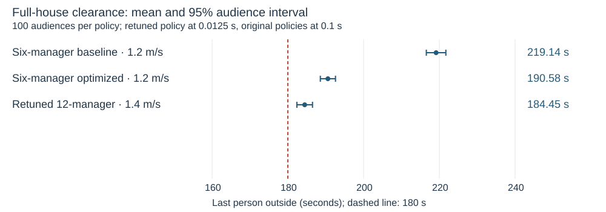
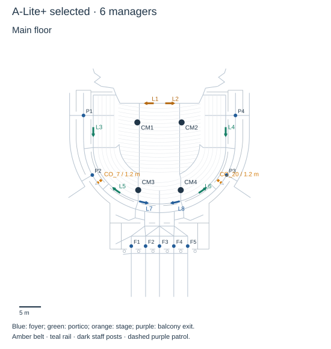
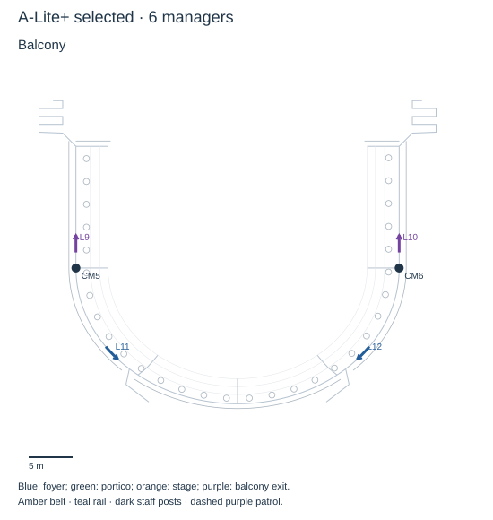
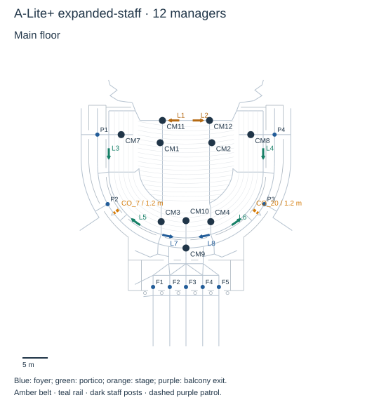
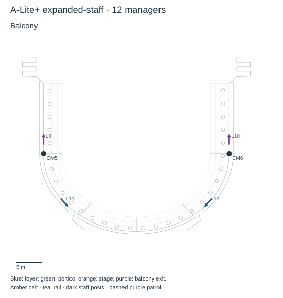

# A-Lite+ results and changes from Mateus’s 04:20 model

## Primary result and interpretation

Finalized at the user’s request using completed cases only. Supplemental ablations, device-isolation comparisons, Q1/Q3 scenario batches, parameter uncertainty, two planned 100-run numerical replays, and the smaller-step diagnostic were not completed. Closure tests are partial. At the prespecified 100-run 0.0125 s step: refined guidance fine (12 managers), 184.45 s [95% CI 182.39–186.51], 32/100 at or below 180. The 100-run 0.0125 s confirmation does not establish a mean below 180 s with a 95% interval wholly below the target. A-Lite+ with six managers gives 190.58 s (95% CI 188.58–192.58) on 100 fresh audiences; 17/100 clear by 180 s and 0 are unresolved. The original six-manager calibration does not demonstrate a mean below 180 seconds. These are research-grounded model predictions, not empirical Bailey validation. The separately declared 1.4 m/s clipped-normal alternative gives 185.63 s (95% CI 183.06–188.21); 38/100 clear by 180 s. Its mean interval does not demonstrate the sub-180 target. The expanded 12-manager policy at 1.4 m/s averages 183.25 s (95% CI 181.20–185.30); 40/100 clear by 180. Its independent mean interval does not demonstrate the sub-180 target.

The validation-selected policy is `optimized-guidance`. It uses six coverage posts, 0 wall signs, 24.0 m of floor strips and 2 physical barriers. Original geometry and 1,329 audience members, including three wheelchair users, remain. The primary physical calibration was frozen before operational search. The endpoint is the last exterior building crossing; assisted travel to street level is separate.

A-Lite+ is recommended as the single comparative planning model because it retains the detailed walkway graph, heterogeneous response and decisions, finite storage, accessible routing and physical device locations while making service conservation explicit. Its simplified queue positions do not resolve body contact or every group interaction. A, B and original Lite remain structural comparisons; Model C is an ideal network-flow benchmark. Choosing the shortest prediction across engines is not calibration.

## What changed, and what stayed fixed

| Component | Change from original Lite / Mateus | Reason and limit |
|---|---|---|
| Transport | Original uncontracted links; conservative service and finite storage retained. Local group pace replaces permanent remote slowest-member pacing; limited passing into empty wide-corridor lanes. | Bode group experiments [R23] motivate separating approach coordination from gate service. The 4 m neighborhood and 1.8 m passing threshold remain assumptions. |
| Individual decisions | Nearby line-of-sight queues and observed discharge; moving people may revise intent before a junction; actual turns require connected nodes. | Travel plus visible wait, persistent preferences, cooldown and hysteresis. No instantaneous remote queue knowledge. |
| Manager instructions | Persistent fixed 0.8 acceptance, independent of trust. Accepted feasible directions commit a destination. Hearing, acceptance and execution logged separately. | Requested behavioral change; 0.8 is assumed, tested at 0.6/0.9. Accessibility takes precedence. Six managers in the primary concert. |
| LEDs | Explicit wall points / floor polylines, visibility, persistent notice and acceptance. Public static/dynamic messages; delayed local/radio controller. | Experimental detection [R24] transfer is uncertain in a dense theatre. No personalized message from a public sign. |
| Barriers | Low belt / open rail / historical opaque panel; explicit span, bypass, width/lane reduction and detour. No arbitrary rope penalty. | Obstacle experiments [R11,R12,R17] do not establish a universal benefit. Reject inaccessible/narrow/exit-blocking placements. Transparent devices preserve sightlines. Hardware footprints and venue approval remain necessary. |
| Numerics and UI | Independent Plus engine factories; original engines retained. Polyline animation, placement editor, inspector, event log, matched comparison, costs and evidence ledger. | Exact source snapshots, seeded configurations and browser parity checks. Performance indexing does not change simulated outcomes. |

The original placement study holds headway, body size, capacities, audience, speed distribution, response and building layout fixed. The later user-requested speed study declares a separate 1.4 m/s alternative before inspecting its outcomes and preserves the original study. The literature review bounded existing assumptions and changed only the stated group/perception/instruction mechanisms before freezing them. Sensitivity values are not ranked to choose a physical calibration; the declared alternative and the original result remain separate. No seat-back crossing or use of another row as a shortcut is permitted.

## Search protocol and independent confirmation

The screen compared 48 physically specified staff/device policies on four common audiences (seed base 73001). The fastest complete training policy supplied the starting layout. The 16 seat blocks most represented among its last 50 evacuees were selected before further optimization. Coordinate descent evaluated 65 distinct plans on six training audiences (73003), for up to two sweeps with a 1 s acceptance threshold. It changed block instructions and pre-announcement, not physical parameters or public sign messages.

A shortlist of 8 policies was evaluated on 16 separate validation audiences (73002). The lowest complete mean among six-manager policies was frozen before the 100 confirmation audiences (73101). A combined-device role was also frozen; if the same policy wins both roles, its result is counted once. Ten- and twelve-manager variants used 16 training audiences (73004); the selected additional-staff option has its own 100-run holdout. All roles were fixed before opening confirmation results. This is a bounded search, not proof of global optimality.

| Policy | Runs | Mean [95% CI], s | p95, s | ≤180; Wilson CI; failed |
|---|---|---|---|---|
| selected | 100 | 190.58 [188.58, 192.58] | 206.59 | 17/100; 11–26%; 0 failed |
| baseline6 | 100 | 219.14 [216.56, 221.72] | 240.40 | 0/100; 0–4%; 0 failed |
| extra staff | 100 | 190.52 [188.04, 192.99] | 214.25 | 17/100; 11–26%; 0 failed |

Selected minus baseline on the same 100 audiences: **-28.56 [-32.07, -25.06] s** (paired 95% interval). Negative means faster. The success fraction requires all 1,329 outside by 180; failures are never removed from a claimed unconditional mean. Confidence intervals describe audience sampling conditional on the model, not unknown Bailey calibration.

## 100-run numerical confirmation of the declared speed and staffing policies

At the prespecified 100-run 0.0125 s step: refined guidance fine (12 managers), 184.45 s [95% CI 182.39–186.51], 32/100 at or below 180. The 100-run 0.0125 s confirmation does not establish a mean below 180 s with a 95% interval wholly below the target.

| Policy | Runs | Mean [95% CI], s | p95, s | ≤180; Wilson CI; failed |
|---|---|---|---|---|
| refined guidance fine | 100 | 184.45 [182.39, 186.51] | 202.74 | 32/100; 24–42%; 0 failed |

Two additional 100-audience numerical refinements were declared before either speed/staff confirmation was opened; they were not completed before the finalization cutoff. Their declarations remain archived. The study never chooses the fastest time step. Audience sampling remains independent of operational selection; the same audiences permit paired numerical comparison. Treat a threshold crossed only at one resolution cautiously. The later guidance retuning has its own declared 100-audience 0.0125 s confirmation on new seed base 73503. Every completed 100-run confirmation is available in the UI with its exact configuration and seeds.

| 0.0125 s minus original 0.1 s result | Paired difference [95% CI], s |
|---|---|
| refined guidance fine | 1.37 [-1.02, 3.77] |

## Smaller-step numerical diagnostic

The 20-audience expanded-policy comparison changed by 2.32 s between 0.025 and 0.0125 s. Before opening any 100-run fine-step result, an additional diagnostic was declared at 0.00625 s on the first twenty matching confirmation audiences of each frozen policy. Only the time step changes. The 100-run 0.0125 s result remains the declared confirmation; no fastest-step substitution is made. The smaller-step diagnostic was declared but not run before finalization. No result from it is claimed.

Not completed before the user-requested finalization cutoff; no result is claimed.

No completed comparison in this section at finalization.

A small difference is a numerical check, not proof of a continuous-time limit; a material change limits the precision of a threshold claim. Changed steps can alter later routing and hearing histories even with identical audiences. Complete policies, seeds and the diagnostic declaration are archived.

## Placements and implementation

| Manager | Position (x, y), m | Floor |
|---|---|---|
| 1 | (-5.10, -3.20) | 1 |
| 2 | (5.10, -3.20) | 1 |
| 3 | (-4.90, 12.40) | 1 |
| 4 | (4.90, 12.40) | 1 |
| 5 | (-18.40, 2.85) | 2 |
| 6 | (18.40, 2.85) | 2 |

| Device | Geometry / setting | Operational interpretation |
|---|---|---|
| CO_7 | belt; length 1.20 m; angle 90°; bypass 1.20 m | Reduced usable width and explicit bypass; no flow bonus |
| CO_20 | belt; length 1.20 m; angle 90°; bypass 1.20 m | Reduced usable width and explicit bypass; no flow bonus |

| LED / floor | Position; initial exit | Type / mode |
|---|---|---|
| L1 / 1 | (-2.33, -7.60); STAGE_W | floor strip / dynamic |
| L2 / 1 | (2.33, -7.60); STAGE_E | floor strip / dynamic |
| L3 / 1 | (-15.25, -1.10); PORTICO_W | floor strip / dynamic |
| L4 / 1 | (15.25, -1.10); PORTICO_E | floor strip / dynamic |
| L5 / 1 | (-9.88, 12.50); PORTICO_W | floor strip / dynamic |
| L6 / 1 | (9.88, 12.50); PORTICO_E | floor strip / dynamic |
| L7 / 1 | (-3.70, 15.21); FOYER | floor strip / dynamic |
| L8 / 1 | (3.70, 15.21); FOYER | floor strip / dynamic |
| L9 / 2 | (-18.40, 0.08); BAL_NW | floor strip / dynamic |
| L10 / 2 | (18.40, 0.08); BAL_NE | floor strip / dynamic |
| L11 / 2 | (-14.32, 12.54); FOYER | floor strip / dynamic |
| L12 / 2 | (14.32, 12.54); FOYER | floor strip / dynamic |

The complete JSON contains every polyline point, orientation, activation, visibility and behavioral parameter. The map uses the actual geometry and posts instantiated by the engine. Dynamic arrows show initial messages; later changes are recorded per run. Coordinates are reconstruction coordinates, not installation survey accuracy. A full open rail is a route closure with transparent sightlines; a partial belt leaves one shared, bidirectional bypass. Hardware supports must fit the assessed envelope. Actual installations require University Fire Marshal review.

## Q4: device comparisons and mechanisms

The 48 whole-policy screening cases include alternative staff, LED and barrier placements. Their raw results and configurations are archived; the separate paired device-isolation batch below was not run before finalization.

Not completed before the user-requested finalization cutoff; no result is claimed.

These are paired ablations of the same combined policy. Public messages, staff count, physical calibration and audience seeds remain fixed while devices change. They distinguish a device effect from the effect of choosing a different staff plan. “Static” means a fixed illuminated instruction; it is not the low-notice unlit baseline sign. Floor strips have no wall-facing cone. Dynamic updates use delivered manager snapshots, not perfect global state.

No completed comparison in this section at finalization.

| Confirmed policy | Mean exit-group use (people/run) |
|---|---|
| selected | FOYER: 513.45; PORTICO_W: 247.66; PORTICO_E: 289.94; STAGE_W: 94.15; STAGE_E: 71.96; BAL_NW: 52.14; BAL_NE: 59.70 |
| baseline6 | FOYER: 598.41; PORTICO_W: 254.67; PORTICO_E: 254.53; STAGE_W: 54.86; STAGE_E: 55.19; BAL_NW: 55.45; BAL_NE: 55.89 |
| extra staff | FOYER: 493.54; PORTICO_W: 256.12; PORTICO_E: 294.35; STAGE_W: 94.76; STAGE_E: 77.46; BAL_NW: 52.76; BAL_NE: 60.01 |

## Controlled model ablations

Not completed before the user-requested finalization cutoff; no result is claimed.

No completed comparison in this section at finalization.

Each ablation changes one mechanism. Utility-only instruction disables commitment for both manager and LED instructions. No-moving-observation disables the extra moving review, while inherited junction decisions remain. Turning off adaptive individuals leaves the local observation hook active but changes the inherited choice/memory engine. These comparisons are not alternative calibrations selected for speed.

## Expanded staffing and moving-post comparison

The expanded 12-manager policy at 1.4 m/s averages 183.25 s (95% CI 181.20–185.30); 40/100 clear by 180. Its independent mean interval does not demonstrate the sub-180 target.

The user-authorized expansion compares 25 explicit placement/patrol policies at the separately declared 1.4 m/s calibration. Counts 6, 8, 10, 12 and 18 use actual posts, rather than a requested number exceeding the available positions. Eight screening audiences (73401) precede sixteen validation audiences (73402) for four finalists. The winner `staff-12-patrol-posts-static` is frozen before 100 new audiences (73403). Its identical 1.2 m/s counterpart and the six-manager 1.4 control are also confirmed on those audiences.

| Policy | Runs | Mean [95% CI], s | p95, s | ≤180; Wilson CI; failed |
|---|---|---|---|---|
| staff 6 coverage | 8 | 186.62 [177.20, 196.05] | 201.35 | 3/8; 14–69%; 0 failed |
| staff 8 coverage | 8 | 184.20 [171.75, 196.65] | 205.22 | 4/8; 22–78%; 0 failed |
| staff 10 coverage | 8 | 183.06 [172.41, 193.71] | 200.93 | 4/8; 22–78%; 0 failed |
| staff 12 coverage | 8 | 180.78 [172.22, 189.33] | 196.16 | 4/8; 22–78%; 0 failed |
| staff 18 coverage | 8 | 178.90 [172.14, 185.66] | 189.80 | 4/8; 22–78%; 0 failed |
| staff 6 decision | 8 | 184.79 [174.12, 195.46] | 201.64 | 3/8; 14–69%; 0 failed |
| staff 6 bottleneck | 8 | 202.54 [189.64, 215.44] | 225.55 | 0/8; 0–32%; 0 failed |
| staff 6 hybrid222 | 8 | 222.49 [211.49, 233.49] | 241.20 | 0/8; 0–32%; 0 failed |
| staff 6 robust | 8 | 191.66 [180.39, 202.93] | 211.98 | 2/8; 7–59%; 0 failed |
| staff 12 decision | 8 | 184.28 [176.23, 192.32] | 194.87 | 2/8; 7–59%; 0 failed |
| staff 12 hybrid222 | 8 | 181.78 [174.60, 188.95] | 192.74 | 4/8; 22–78%; 0 failed |
| staff 18 decision | 8 | 186.85 [175.78, 197.92] | 202.88 | 3/8; 14–69%; 0 failed |
| staff 18 hybrid222 | 8 | 184.86 [173.80, 195.92] | 199.63 | 3/8; 14–69%; 0 failed |
| staff 6 adaptive | 8 | 190.89 [176.72, 205.05] | 215.50 | 3/8; 14–69%; 0 failed |
| staff 12 adaptive | 8 | 180.78 [172.22, 189.33] | 196.16 | 4/8; 22–78%; 0 failed |
| staff 18 adaptive | 8 | 178.90 [172.14, 185.66] | 189.80 | 4/8; 22–78%; 0 failed |
| staff 6 patrol posts static | 8 | Unresolved | — | 4/8; 22–78%; 1 failed |
| staff 6 patrol20 | 8 | Unresolved | — | 4/8; 22–78%; 1 failed |
| staff 6 patrol45 | 8 | Unresolved | — | 4/8; 22–78%; 1 failed |
| staff 12 patrol posts static | 8 | 177.50 [169.21, 185.79] | 193.52 | 6/8; 41–93%; 0 failed |
| staff 12 patrol20 | 8 | 181.43 [167.71, 195.14] | 206.79 | 5/8; 31–86%; 0 failed |
| staff 12 patrol45 | 8 | 181.07 [170.06, 192.09] | 202.88 | 6/8; 41–93%; 0 failed |
| staff 18 patrol posts static | 8 | 182.47 [172.86, 192.09] | 196.19 | 3/8; 14–69%; 0 failed |
| staff 18 patrol20 | 8 | 181.35 [170.85, 191.85] | 199.93 | 5/8; 31–86%; 0 failed |
| staff 18 patrol45 | 8 | 178.99 [169.07, 188.90] | 198.31 | 6/8; 41–93%; 0 failed |

| Policy | Runs | Mean [95% CI], s | p95, s | ≤180; Wilson CI; failed |
|---|---|---|---|---|
| staff 12 patrol posts static | 16 | 184.10 [178.93, 189.27] | 197.40 | 5/16; 14–56%; 0 failed |
| staff 18 coverage | 16 | 186.32 [180.53, 192.12] | 202.50 | 5/16; 14–56%; 0 failed |
| staff 18 adaptive | 16 | 186.32 [180.53, 192.12] | 202.50 | 5/16; 14–56%; 0 failed |
| staff 18 patrol45 | 16 | 192.26 [184.62, 199.90] | 210.62 | 5/16; 14–56%; 0 failed |

| Policy | Runs | Mean [95% CI], s | p95, s | ≤180; Wilson CI; failed |
|---|---|---|---|---|
| expanded staff 1.4 | 100 | 183.25 [181.20, 185.30] | 199.50 | 40/100; 31–50%; 0 failed |
| same staff 1.2 | 100 | 192.55 [190.44, 194.67] | 207.62 | 13/100; 8–21%; 0 failed |
| six manager 1.4 control | 100 | 188.31 [186.02, 190.60] | 207.53 | 26/100; 18–35%; 0 failed |

| Patrol candidate | Total managers | Managers with feasible patrols |
|---|---|---|
| staff-6-patrol20 | 6 | 0 |
| staff-6-patrol45 | 6 | 0 |
| staff-12-patrol20 | 12 | 3 |
| staff-12-patrol45 | 12 | 3 |
| staff-18-patrol20 | 18 | 3 |
| staff-18-patrol45 | 18 | 3 |

Only posts within 4 m of an eligible wide-corridor node receive a patrol. The six coverage posts have no qualifying route, so their patrol-labeled cases are stationary fallbacks, not evidence about moving guides. The 12- and 18-post layouts each contain three eligible patrols; all remaining managers stay at their posts. Full-run motion audits and the browser replay use the actual 12-manager patrol case.

The six-post explicit stationary representation has identical post coordinates and activation draws to the coverage template, but consumes six rather than the geometry's ten potential-post activation draws from the inherited guidance stream. Subsequent hearing draws therefore differ. This does not change the sampled audience or marginal hearing law, but it prevents attributing a seed-by-seed difference between those two representations to placement. Patrol effects are compared with their own explicit, stationary-post controls. Any unresolved audience excludes that candidate, regardless of its completion-conditioned mean.

The rejected six-post explicit candidate illustrates a counterflow failure. In seed 31553826, opposing ready queues fill the existing 0.9 m passages SPW_2 and SPW_3. The two queue heads have combined modeled body diameters of 0.935 m, so the conservative side-by-side exchange rule cannot release them. Twelve people remain inside at the 900 s horizon. No body radius, passage width or storage limit was relaxed to clear that run. The model lacks body rotation and negotiated retreat, so this is a failure under its spatial-queue assumptions, not proof that Bailey would physically trap those people. `rejected-run-diagnostic.json` preserves the queue states and the calculation.

Expanded staffing minus six-manager control, both at 1.4 m/s on the same 100 audiences: **-5.06 [-8.14, -1.98] s**. The different-speed counterpart is reported separately, so a speed effect is not attributed to staffing.

Moving managers follow explicit wide, level, non-gate walkway sequences. They start at 20 or 45 s, move at 1.0 m/s only while their link is empty of audience members, and dwell 10 s at each end. Static controls use identical starting posts. Existing hearing, persistent acceptance, observation and radio delays remain. The controlled guidance study by Liu et al. [R28] motivates distinguishing guidance modes and locations; its platform performance and attraction coefficients are not imported. Staff bodies are absent from queue storage and the audience endpoint, so patrol results remain a limited coverage sensitivity, not validated staff–crowd mechanics.

| Policy | Runs | Mean [95% CI], s | p95, s | ≤180; Wilson CI; failed |
|---|---|---|---|---|
| expanded reference | 20 | 187.44 [181.12, 193.76] | 206.65 | 6/20; 15–52%; 0 failed |
| expanded dt0.025 | 20 | 183.65 [178.26, 189.03] | 203.33 | 9/20; 26–66%; 0 failed |
| expanded dt0.0125 | 20 | 181.33 [176.47, 186.19] | 198.03 | 10/20; 30–70%; 0 failed |
| expanded F3 | 20 | 220.04 [216.42, 223.66] | 231.91 | 0/20; 0–16%; 0 failed |
| expanded F3 without barriers | 20 | 246.28 [239.58, 252.98] | 270.87 | 0/20; 0–16%; 0 failed |
| expanded FC2 | 20 | 188.86 [183.14, 194.58] | 204.09 | 6/20; 15–52%; 0 failed |
| expanded FC2 without barriers | 20 | 187.71 [181.04, 194.37] | 210.65 | 8/20; 22–61%; 0 failed |

| Expanded policy check minus same-seed reference | Paired difference [95% CI], s |
|---|---|
| expanded dt0.025 | -3.79 [-9.72, 2.13] |
| expanded dt0.0125 | -6.11 [-12.74, 0.52] |
| expanded F3 | 32.60 [26.46, 38.74] |
| expanded F3 without barriers | 58.84 [50.19, 67.49] |
| expanded FC2 | 1.42 [-5.82, 8.66] |
| expanded FC2 without barriers | 0.27 [-8.73, 9.26] |

Additional passive audits cover 6 expanded, twelve-manager patrol and blocked runs; 0 forbidden transitions. Every step checks finite staff travel and the occupied-link waiting rule, alongside audience service, storage and conservation.

## Final operational retuning of the selected additional-staff layout

The prior instructions were optimized for six managers. Queue-sensitive route allocation motivates a further operational comparison [R7, R10]. A final bounded search keeps the selected 12 posts, the declared 1.4 m/s distribution, devices and every physical/behavioral parameter fixed. It changes only manager and pre-announcement seat-block destinations. Eight new training audiences (73501) compare the inherited plan and four coherent west/east side-zone patterns; the eight most frequent non-side tail blocks then receive one coordinate-descent sweep, accepting gains above 1 s. This evaluates 21 plans. The inherited, best-pattern and refined candidates use twenty separate validation audiences (73502). The selected role `coordinate-refinement` is frozen before 100 new audiences (73503), then always rerun at 0.0125 s. This last search stops regardless of the target; no physical parameter is tuned to its outcomes.

| Policy | Runs | Mean [95% CI], s | p95, s | ≤180; Wilson CI; failed |
|---|---|---|---|---|
| inherited | 20 | 188.68 [183.65, 193.71] | 203.63 | 3/20; 5–36%; 0 failed |
| best side pattern | 20 | 189.31 [183.27, 195.35] | 211.52 | 4/20; 8–42%; 0 failed |
| coordinate refinement | 20 | 185.48 [181.73, 189.23] | 194.69 | 5/20; 11–47%; 0 failed |

| Policy | Runs | Mean [95% CI], s | p95, s | ≤180; Wilson CI; failed |
|---|---|---|---|---|
| refined guidance | 100 | 183.07 [180.95, 185.19] | 200.41 | 47/100; 38–57%; 0 failed |
| refined guidance fine | 100 | 184.45 [182.39, 186.51] | 202.74 | 32/100; 24–42%; 0 failed |

Devices and staff locations are identical to the expanded-staff maps above. Public LEDs keep their spatial messages; only the following accepted staff/pre-announcement destinations differ.

| Seat block | Inherited destination | Final destination |
|---|---|---|
| ORCH_SIDE_W:W:F | FOYER | PORTICO_W |
| MEZZ_E:E:B | PORTICO_E | FOYER |

| Policy | Runs | Mean [95% CI], s | p95, s | ≤180; Wilson CI; failed |
|---|---|---|---|---|
| refined F3 | 12 | 220.93 [217.15, 224.70] | 229.92 | 0/12; 0–24%; 0 failed |
| refined F3 without barriers | 12 | 254.33 [244.92, 263.74] | 277.97 | 0/12; 0–24%; 0 failed |
| refined FC2 | 12 | 182.03 [178.50, 185.56] | 191.53 | 3/12; 9–53%; 0 failed |

The final policy’s additional passive audits were not run before finalization. The earlier ten full-run physical audits remain available. Its confirmation audiences differ from the earlier staffing study; cross-study mean differences are not paired causal estimates.

| Staffing / refined policy | Exposure / peak density | Mean exit-group use |
|---|---|---|
| expanded staff 1.4 | 10992 / 4.49 | FOYER: 493.82; PORTICO_W: 256.96; PORTICO_E: 296.64; STAGE_W: 94.07; STAGE_E: 75.80; BAL_NW: 52.22; BAL_NE: 59.49 |
| same staff 1.2 | 10481 / 4.49 | FOYER: 493.84; PORTICO_W: 255.80; PORTICO_E: 296.32; STAGE_W: 93.99; STAGE_E: 76.31; BAL_NW: 52.84; BAL_NE: 59.90 |
| six manager 1.4 control | 11472 / 4.49 | FOYER: 510.17; PORTICO_W: 248.36; PORTICO_E: 294.87; STAGE_W: 93.72; STAGE_E: 70.36; BAL_NW: 52.09; BAL_NE: 59.43 |
| refined guidance fine | 11420 / 4.49 | FOYER: 507.27; PORTICO_W: 286.02; PORTICO_E: 254.67; STAGE_W: 93.96; STAGE_E: 75.76; BAL_NW: 51.90; BAL_NE: 59.42 |

## Q2: unexpected obstruction and communication

Not completed before the user-requested finalization cutoff; no result is claimed.

F3 is an exterior foyer door, FC2 a foyer connection and D3 a side connection. In discovery cases, closures are physically present from the start but unknown until visible or communicated. The announced FC2 case introduces staff knowledge after 45 s. No exit is widened and no closure is inferred to improve physical capacity merely because it changes route choices. Compare the same device plan with and without barriers under the same closure before recommending a barrier. A substantial adverse paired effect or unresolved audience is a reason to withhold that installation, even if its open-building mean is faster.

The complete declared obstruction screen was not finished. **No barrier installation recommendation is made.** Completed pairs are reported below; an absent test is not a pass.

| Study | Closure | Paired barrier minus no-barrier difference, s | Status |
|---|---|---|---|
| obstructions | F3 | Unrun | Not completed |
| obstructions | FC2 | Unrun | Not completed |
| obstructions | D3 | Unrun | Not completed |
| staff-expansion-robustness | F3 | -26.24 [-33.02, -19.46] | No deterioration above the declared 5 s screen |
| staff-expansion-robustness | FC2 | 1.16 [-5.89, 8.20] | No deterioration above the declared 5 s screen |
| staff-expansion-robustness | D3 | Unrun | Not completed |
| guidance-refinement-robustness | F3 | -33.41 [-44.97, -21.85] | No deterioration above the declared 5 s screen |
| guidance-refinement-robustness | FC2 | Unrun | Not completed |
| guidance-refinement-robustness | D3 | Unrun | Not completed |

## Q1 and Q3: different uses of the same model

Not completed before the user-requested finalization cutoff; no result is claimed.

Q1 uses the inherited ordinary-departure distribution: longer belongings preparation, habitual foyer use, urgency zero and mean desired speed 1.1 m/s. Six staff are represented at their posts, but emergency redirection is inactive; the second case is an operational sensitivity with active directions. This separates staff presence from an emergency instruction. Ordinary-preparation coefficients remain assumptions, not measured concert behavior.

Q3 keeps the full 1,329 audience and three wheelchair users, removes managers, and makes emergency-exit knowledge complete as the problem explicitly states. The inherited student scenario has no elderly share, mean desired speed 1.35 m/s, fewer groups, more belongings and response median 22 s. The 14 s response case tests that uncertain assumption. The device case uses fixed messages because no manager/radio controller is available. Student familiarity is knowledge, not perfect compliance. These changes answer a different competition scenario; they do not substitute a younger audience into Q2.

## Transferred-calibration uncertainty

Not completed before the user-requested finalization cutoff; no result is claimed.

All changes in this table are one-at-a-time sensitivity hypotheses, never operational winners. LED sensitivities use the combined-device reference; other rows use the six-manager selection. They bound dependence on free speed, rows, headway, stair pace, gate rates, response, storage and instruction uptake. Changing headway changes implied lane throughput. A faster row cap is motivated as an alternative by lecture-room research but is not measured Bailey calibration. These intervals still cover audience variability only; the spread between parameter cases illustrates additional model uncertainty.

## User-requested free-speed and right-skew follow-up

The separately declared 1.4 m/s clipped-normal alternative gives 185.63 s (95% CI 183.06–188.21); 38/100 clear by 180 s. Its mean interval does not demonstrate the sub-180 target.

The concert originally uses a 1.20 m/s mean before age adjustment; 1.35 belongs to the inherited lecture scenario. The alternative 1.40 was declared before speed outcomes, informed by controlled corridor measurements in Ren et al. [R26]. This is an external experimental transfer, not a Bailey measurement. The original 25% older share, .78 speed factor, .25 m/s pre-age SD, wheelchair speed, row cap, headway, gate rates and operational layout remain fixed. Davidich and Köster [R27], show why context-specific field calibration can differ from standard laboratory values. The model guide gives the exact sampling equations and research limitations.

| Policy | Runs | Mean [95% CI], s | p95, s | ≤180; Wilson CI; failed |
|---|---|---|---|---|
| normal 1.2 | 20 | 190.20 [186.20, 194.20] | 203.22 | 3/20; 5–36%; 0 failed |
| normal 1.35 | 20 | 183.48 [178.67, 188.29] | 198.18 | 6/20; 15–52%; 0 failed |
| normal 1.4 | 20 | 188.25 [181.16, 195.35] | 210.19 | 6/20; 15–52%; 0 failed |
| normal 1.5 | 20 | 186.62 [181.15, 192.08] | 208.70 | 7/20; 18–57%; 0 failed |
| lognormal 1.2 | 20 | 191.30 [184.05, 198.55] | 219.90 | 5/20; 11–47%; 0 failed |
| lognormal 1.4 | 20 | 185.72 [178.56, 192.87] | 211.21 | 8/20; 22–61%; 0 failed |

| Speed family / input mean | Sampled ambulant mean / SD | Younger / older mean |
|---|---|---|
| normal-1.2 | 1.134 / 0.263 m/s | 1.199 / 0.934 m/s |
| normal-1.35 | 1.275 / 0.270 m/s | 1.348 / 1.050 m/s |
| normal-1.4 | 1.322 / 0.271 m/s | 1.398 / 1.089 m/s |
| normal-1.5 | 1.415 / 0.274 m/s | 1.496 / 1.167 m/s |
| lognormal-1.2 | 1.133 / 0.261 m/s | 1.198 / 0.933 m/s |
| lognormal-1.4 | 1.321 / 0.267 m/s | 1.396 / 1.089 m/s |

Normal and lognormal families use the same person-specific random draw and match their pre-clipping mean and standard deviation. They are both clipped to the inherited 0.5–2.0 m/s bounds after age adjustment. Right skew is not an overall speed increase: it changes the median and tails, and the last-person endpoint can be sensitive to slower walkers. The study reports sampled moments rather than assuming clipping has no effect. The 1.5 sensitivity is not promoted just because it might be faster. Mean-speed changes also affect representative walkway service through J=v/(0.44+0.70v), while door/stair gate capacities remain unchanged.

| Policy | Runs | Mean [95% CI], s | p95, s | ≤180; Wilson CI; failed |
|---|---|---|---|---|
| selected | 100 | 190.58 [188.58, 192.58] | 206.59 | 17/100; 11–26%; 0 failed |
| speed alternative 1.4 | 100 | 185.63 [183.06, 188.21] | 210.63 | 38/100; 29–48%; 0 failed |

Declared 1.4 alternative minus original on the same 100 audiences: **-4.95 [-7.61, -2.28] s**. The policy was frozen without using these confirmation audiences. A lower mean is a conditional prediction under a different free-speed assumption, not an operational device benefit.

## Time-step sensitivity and conservation

Not completed before the user-requested finalization cutoff; no result is claimed.

No completed comparison in this section at finalization.

The selected physical policy is unchanged across steps. Finer integration reduces arrival/admission rounding but can also alter later hearing and route histories; individual runs need not change monotonically. The original six-manager 1.2 m/s confirmation uses its frozen 0.1 s step. The original-policy twenty-audience refinement was not completed. The expanded-staff study did complete twenty-audience comparisons at 0.1, 0.025 and 0.0125 s, and the retuned policy completed 100 audiences at both 0.1 and 0.0125 s. The other two 100-run fine-step replays were not completed. No fastest-step substitution is made. Passing component tests does not establish exact continuous-time convergence.

Passive full-run audits cover 4 selected/combined/blocked runs, 77,988 graph transitions and 5,303,219 occupied-position checks. They found **0 forbidden transitions**, and checked every link's storage, population conservation and cumulative directional/gate service every step. Queue-display relocation within a link is recorded separately; it is not a physical walking trajectory or a shortcut over seats.

## Model C benchmark and the late tail

| Flow benchmark | Result | Interpretation |
|---|---|---|
| Static max flow | 17.18 people/s | Capacity benchmark; 7.383 people/s is the full-house whole-run requirement |
| immediate | 101.00 s / 1326 people | Representative speed, optimal routing; wheelchair users excluded |
| intrinsic | 149.00 s / 1326 people | Representative speed, optimal routing; wheelchair users excluded |

A-Lite+ is an individual, network-based queue simulation. It does not solve a max-flow problem to force optimal human decisions. C alone optimizes network flow. Its representative-speed ambulant benchmark omits wheelchair travel, heterogeneous decisions and operational information limits, so it is neither an attainable full-house prediction nor a universal lower bound on every heterogeneous run.

| Late-tail diagnostic | Selected policy, 100 audiences |
|---|---|
| Mean start of last 50 | 27.58 s |
| Mean accumulated waiting before building crossing | 94.28 s |
| Most represented seat zones | ORCH_C_BACK: 1515, ORCH_C_FRONT: 1150, ORCH_SIDE_W: 556, ORCH_FRONT_E: 347, ORCH_SIDE_E: 342, MEZZ_E: 317 |

| Confirmed policy | LED noticed / first notice (s) | Destination switches by cause | Density exposure / peak |
|---|---|---|---|
| selected | 1239 / 19.00 | switch-manager: 193.3; switch-observation: 3.6; switch-sign: 320.6 | 10579 / 4.49 |
| baseline6 | 0 / — | switch-manager: 62.2; switch-observation: 14.3; switch-sign: 5.0 | 5464 / 4.49 |
| extra staff | 1238 / 18.63 | switch-manager: 184.5; switch-observation: 3.0; switch-sign: 290.3 | 10367 / 4.49 |

## Q5: costs and practical feasibility

Expanded staffing uses 12 managers, with illustrative capital \$2060 and staffing \$1440 per event. The incremental staff cost versus six is \$720 per event. This resource increase is explicit, not a six-manager result.

| Confirmed policy | Staff / signs / strip metres / barriers | Capital / staff per event |
|---|---|---|
| selected | 6 / 0 / 24.0 / 2 | \$2060 / \$720 |
| baseline6 | 6 / 0 / 0.0 / 0 | \$0 / \$720 |
| extra staff | 12 / 0 / 24.0 / 2 | \$2060 / \$1440 |

Costs are editable illustrative USD assumptions: \$120 per manager-event, \$250 per wall sign, \$40 per metre of strip, \$150 per barrier and \$800 for a dynamic controller. They exclude installation labor, power, maintenance, storage, removals, replacement and venue approval. No retrieved quote establishes a suitable Bailey dynamic LED system. As external price anchors checked 8 November 2026, [Uline H-3736](https://www.uline.com/BL_8917/Retractable-Crowd-Control?keywords=PL-S) lists \$119 per carton of two belt posts, and [Crowd Manager Training](https://crowdmanagers.com/purchase/) lists \$24.95 per person for a two-hour course with a two-year certificate. These are product/training prices, not an installed design or staff wage quote. Post bases must be included in a real clear-width assessment.

For E events, compare capital + E × staffing + installation + maintenance + training. Dividing device capital by the additional staffing cost per event shown above gives a budget break-even only if recurring device costs are omitted. It does not establish equivalent evacuation performance. Keep the six-manager primary result separate from extra-staff results, and do not remove required staff to fund devices. Device usability, power, accessible bypass, message consistency and obstruction robustness all affect implementation complexity.

## Reproducibility, tests and remaining limits

Verification completed 171 tests across 16 files with no failures, and the production build passed. The suite includes legacy regression, conservation, service, accessibility, physical sign/barrier semantics, moving-post restrictions and seeded speed-family checks. Browser interaction and final replay records are stored alongside the study; their exact checks and timestamps remain separately inspectable.

This final Plus study contains **2,430 experiment replications**, excluding passive audits, component tests and browser replays. Raw cases, seeds, configurations, source snapshots and all optimization trials are archived losslessly. Training, validation, holdout and supplementary seed bases are distinct. The source and geometry hashes in the freeze and batch files identify the exact implementation. Performance-only visibility changes reproduced 12 baseline/device runs exactly before screening resumed.

Open the A-Lite+ tab at `http://127.0.0.1:5180/?tab=plus`. Load `selected-six` (original 1.2 m/s) or `speed-alternative-1.4`, reset, choose a listed confirmation seed and start. For the mean, use Prepare 100-run reproduction, then Run matched comparison; this restores base 73101 and the exact saved policy. The independent-results table exposes exact configurations; the matched comparison uses common audiences. A study mean is not a single seed, and the live clock can continue after building clearance for outdoor travel/assistance. The editor and runtime share the same installation overlay. Invalid bypasses are rejected; configuration export/import preserves layouts.

The professional model guide derives the mathematics and supplies the full evidence ledger. The original A-Lite simplification audit documents its transport foundation. Remaining limits include reconstructed dimensions, inferred sign mounting, no head occlusion or photometry, approximate acoustic reach, whole-link occupancy at visible walkway junctions, full queue counts and configured rates at visible staff-observed gates, persistent stale gate reports, simulated zone-demand counts in adaptive staff forecasts, a shared staff closure flag for multi-closure configurations, queue-position approximation, unmeasured group behavior/compliance, staff bodies absent from flow, and no fire tenability or injury mechanics. Computational verification cannot supply missing Bailey observations. The defensible next calibration work is to measure response, row/aisle flow, exit counts, sign legibility and staff audibility, then fit and validate on separate events. The target itself is never a calibration datum.

## Historical comparisons retained

The following earlier studies use different engines and instruction/barrier semantics, so they are not interchangeable with Plus. The original 04:20 commit is `3e4bcf08e258e5db41b0035e307415bf129bc011`. Legacy A and B remain available, and their configurations and source snapshots remain archived. The original six-manager placement study gave A 230.1 s, Lite 194.2 s and B 182.6 s on 40 audiences. These are means of a specific policy, not default-seed outputs.

The subsequent original-Lite route study evaluated 217 block plans and 84 placements, then froze two roles before 60 fresh audiences: the overall plan averaged 186.87 s in Lite (A 212.39, B 183.41); its combined-device role averaged 188.83 s in Lite (A 214.87, B 179.47). At the prespecified finest 0.0125 s step the same Lite policies averaged 186.84 and 190.45 s. None demonstrates the Lite target. The faster B value is a different abstraction, including optimistic storage relief; it does not establish Plus performance. Full raw tables and configurations are in `results/route-study` and the historical study UI.

Earlier rope studies used a perceived crossing penalty; Plus uses physical bypass width and detour instead. Earlier utility-based acceptance merely influenced preferences; Plus commits accepted instructions. These changes can lengthen as well as shorten time. They were adopted for interpretable mechanisms before the final search, not chosen retrospectively for a faster mean.
