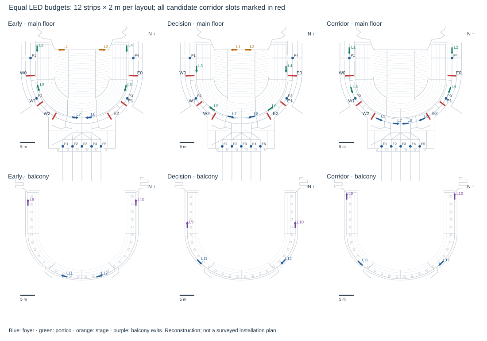
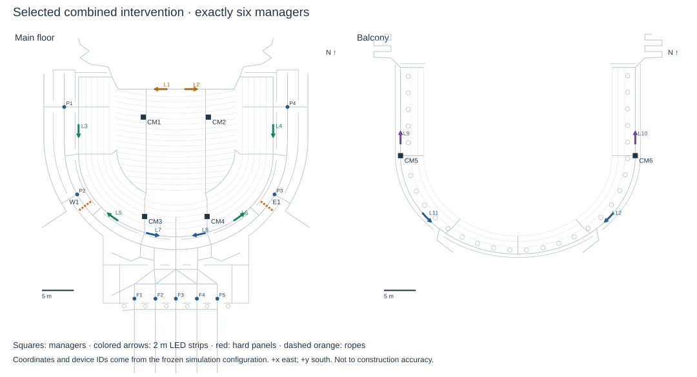

# What changed after 04:20 — and did it reach 180 seconds?

<!-- SIX_MANAGER_START -->
## Current scope: six managers and the original problem constraints
This update addresses **Question 2** (full-house concert emergency, including an initially unknown blocked exit) and **Question 4** (removable corridor barriers and directional LED strips). The original seven-page *Bail(ey)ing Out* PDF was reread, including the evacuation plans and seating maps. The brief requires at least six managers; this comparison uses **exactly six**, as requested. Earlier 10/18-manager results remain historical resource sensitivities.

| Constraint | Source page | Treatment |
|---|---|---|
| 1,329 occupants, including up to three wheelchair users | 2–3 | All 1,329 retained, including three wheelchair users; not 1,329 plus three. |
| Declaration to last person outside | 1–2 | Response time included; no 180 s censoring; building boundary and street safety reported separately. |
| At least six staff at concerts | 2 | Exactly six actual posts; no staff removed by the device interventions. |
| Temporary corridor barriers; directional floor/wall LEDs | 2 | Original corridor slots and finite floor-strip segments; no physical rate or width bonus. |
| Exit obstruction and execution error | 2 | Matched discovery-mode blocked-door tests; visibility and notice sensitivities. |
| No elevator; preserve building layout | 3–7 | Original graph and prohibited links unchanged; all candidate rows and wheelchair seats retain an egress path. |
| One-page executive summary, explicit questions addressed | 2–3 | Summary addressed to Timothy Ryan precedes this report; Questions 2 and 4 selected. |

The user's target is an average below 180 s. The brief's wording is stricter: an evacuation must finish under 180 s. The report therefore shows both the mean last-person time and the count at or below 180. Graph connectivity does not establish installation feasibility, body-level pressure, smoke tenability or empirical accuracy. The full audit is `CONSTRAINTS.md`.

## Why your Model A run can differ from 230 seconds

The historical refined A result is **231.2475 s**, averaged over 40 specified audiences. It uses six existing managers, W1/E1 hard corridor panels, pre-announcement, abstract LEDs, adaptive managers and conservative service integration. The default concert baseline is **268.645 s** on the same audiences. The configuration's stored seed 1 is not the batch's first generated seed.

The archived refined A audience with seed **2132682877** leaves the building at **235.1 s**, the last ambulatory person reaches street level at **266.0 s**, and all-person street safety including scheduled wheelchair assistance is **282.7 s**. Individual clearance times in that 40-run batch span **212.9–260.1 s**. The interface's former prominent clock included outside travel and assistance; it was not the study's clearance metric. The live view now displays building clearance separately. The study tab loads exact configurations, replays a known audience, and reproduces the complete archived seed list.

A fresh current-code audit reproduced **all 1,000 runs** in the original A/B and later A-Lite main confirmation archives, including the known incomplete corrected-A case. Numerical run fields match; measured CPU runtime is excluded. Real browser checks independently matched the live A/B results and all 40 refined A worker results. Multiple local checkouts were serving different code on ports 5173/5174; this worktree serves port 5180. A shared Vite dependency cache also caused duplicate-React errors; the cache is now local to this checkout.

The generic Monte Carlo summary previously could show a completion-conditioned mean when another audience failed. It now reports no finite full-house mean for an incomplete batch, preserving failures in the success fraction. This display correction does not change trajectories. Reproduction verifies implementation consistency; it cannot establish agreement with a real Bailey evacuation without calibration data.

## Placement experiment and resource budget

Three six-manager layouts (existing, seat coverage, decision points), four LED choices (none, early approach, decision areas, corridor/exit approach) and seven barrier choices give **84 configurations**, each tested on four common training audiences. Barrier choices are none; hard W0/E0, W1/E1, W2/E2; W1/E1 ropes; and asymmetric hard W0/E2 or W2/E0. Thus symmetry is tested, not presumed.

The same expanded seat-block instructions and pre-announcement are used throughout the screen. Staff have acoustic reach and individual message hearing; congestion redirection is initially held static, while closure handling remains enabled. Four additional zone-control variants enter the longer shortlist. Physical probabilities remain 0.9 notice and 0.7 acceptance for LEDs, 0.8 base staff acceptance, with inherited imperfect hearing. Ropes add 15 perceived seconds, a sensitivity assumption rather than an observed Bailey deterrent.

Each LED layout uses **twelve 2 m floor strips, 24 m total**, clipped to existing links. The message is public and fixed; no strip reads a person's original seat. Range is 12 m, same-floor only, with walls, columns and hard panels occluding. One notice/acceptance opportunity uses the original random draws. Body occlusion, height, luminance and optical smoke effects are not calibrated. The strips are localized cues, not an uninterrupted illuminated route. Floor strips are visible from either side; arrow direction is distinct from the facing cone of a wall sign. Model Guide equation 25 specifies the finite-strip visibility calculation.

Bernardini et al. [R20] support investigating low-level directional cues and message comprehension, using isolated-person VR evidence. Galea et al. [R8] support message consistency. Neither establishes Bailey's notice/acceptance values. Barrier experiments [R11–R12,R17] show configuration-dependent benefits and harm; no published percentage is pasted onto capacity.



## Training selection, fixed before independent confirmation

The shortlist contains **17 candidates**, each evaluated on 12 new training audiences (base seed 61007), after screening with base seed 61006. Selection was frozen before viewing the 40-audience confirmation set (61106). The lowest training mean selected `decision-none-rope1` overall; the best candidate containing both devices selected `coverage-decision-rope1`. These are two prespecified roles, not a choice of the best holdout result.


| Training configuration | Mean s [95% CI] | Failures |
|---|---|---|
| decision-none-rope1 | 191.6 [182.8, 200.5] | 0 |
| zone-none-hard1 | 193.1 [182.1, 204.0] | 0 |
| coverage-decision-rope1 | 193.8 [186.7, 200.8] | 0 |
| decision-none-hard1 | 194.6 [185.9, 203.4] | 0 |
| decision-corridor-hard1 | 194.8 [184.6, 205.0] | 0 |
| zone-corridor-hard1 | 195.8 [187.6, 204.0] | 0 |
| existing-none-rope1 | 199.5 [185.1, 214.0] | 0 |
| zone-decision-hard1 | 201.7 [186.0, 217.5] | 0 |

## Independent six-manager comparison

Exactly six managers: the preselected combined plan gives 230.1 s in A, 194.2 s in A-Lite and 182.6 s in B (40 independent audiences each). The mean 180-second target is not demonstrated.

| Configuration / model | Mean s [95% CI] | ≤180 | Unresolved |
|---|---|---|---|
| Training-selected overall plan / A | 232.7 [229.4, 236.1] | 0/40 | 0/40 |
| Training-selected overall plan / B | 190.5 [186.2, 194.8] | 9/40 | 0/40 |
| Training-selected overall plan / Lite | 201.2 [195.0, 207.5] | 3/40 | 0/40 |
| Training-selected LEDs + barriers / A | 230.1 [226.6, 233.6] | 0/40 | 0/40 |
| Training-selected LEDs + barriers / B | 182.6 [178.7, 186.5] | 18/40 | 0/40 |
| Training-selected LEDs + barriers / Lite | 194.2 [189.1, 199.3] | 7/40 | 0/40 |
| Same combined plan, LEDs off / Lite | 194.7 [190.1, 199.4] | 3/40 | 0/40 |
| Same combined plan, barriers removed / Lite | 218.2 [213.5, 222.9] | 0/40 | 0/40 |
| Same posts and messages, both devices off / A | 235.7 [231.9, 239.6] | 0/40 | 0/40 |
| Same posts and messages, both devices off / B | 189.4 [185.6, 193.1] | 8/40 | 0/40 |
| Same posts and messages, both devices off / Lite | 216.1 [211.3, 221.0] | 0/40 | 0/40 |
| Existing posts, no devices / Lite | 219.2 [214.5, 223.9] | 0/40 | 0/40 |

Negative paired differences mean faster; confidence intervals describe the paired audience sample. The intervention comparison keeps posts, instructions and pre-announcement fixed.

| A-Lite paired comparison | Difference s [95% CI] |
|---|---|
| Combined minus neither device | -21.91 [-26.89, -16.92] |
| Add LEDs to same barrier plan | -0.54 [-4.48, 3.40] |
| Add ropes to same LED plan | -24.00 [-28.25, -19.74] |

The combined policy is retained as the prespecified device comparison even if the overall training winner performs differently on confirmation. A small LED difference with an interval containing zero is not evidence of a reliable improvement. Simpler device layouts can be preferable when the effect is uncertain. Search does not prove a global optimum.

| Combined plan / model | Max local density, persons/m² | Mean exposure, persons·s/m² |
|---|---|---|
| A | 5.8 | 19.1 |
| Lite | 4.5 | 14.5 |
| B | 9.7 | 18.5 |

Exposure integrates density above 2 persons/m² per person, then averages over people and runs. This is an analytical comparison, not a safety threshold. Local A windows, Lite whole-link averages and B edge averages differ in resolution; their peak values are not interchangeable.

## Where the selected devices and six managers are

The combined plan uses **coverage** posts, **decision** LED placement, and **rope1** barriers. The frozen configuration contains every polyline point, arrow message, staff setting and seat-block instruction.



| Strip / existing link | Floor | Centre (x, y), m | Public destination |
|---|---|---|---|
| L1 / FX_2 | 1 | (-2.33, -7.60) | STAGE_W |
| L2 / FX_3 | 1 | (2.33, -7.60) | STAGE_E |
| L3 / WK_2 | 1 | (-15.25, -1.10) | PORTICO_W |
| L4 / WK_9 | 1 | (15.25, -1.10) | PORTICO_E |
| L5 / WK_4 | 1 | (-9.88, 12.50) | PORTICO_W |
| L6 / WK_7 | 1 | (9.88, 12.50) | PORTICO_E |
| L7 / WK_5 | 1 | (-3.70, 15.21) | FOYER |
| L8 / WK_6 | 1 | (3.70, 15.21) | FOYER |
| L9 / BWK_1 | 2 | (-18.40, 0.08) | BAL_NW |
| L10 / BWK_8 | 2 | (18.40, 0.08) | BAL_NE |
| L11 / BWK_2 | 2 | (-14.32, 12.54) | FOYER |
| L12 / BWK_7 | 2 | (14.32, 12.54) | FOYER |

Each listed strip is 2 m long along its existing link. Coordinates use east-positive x and south-positive y; they are reconstruction coordinates, not surveyed installation dimensions. Full ordered endpoints are retained in the JSON and drawn as arrows.


| Manager | Existing: (x,y,floor) | Coverage: (x,y,floor) | Decision: (x,y,floor) |
|---|---|---|---|
| CM1 | (-12.8, -4.8, 1) | (-5.1, -3.2, 1) | (0, -7, 1) |
| CM2 | (12.8, -4.8, 1) | (5.1, -3.2, 1) | (0, 12, 1) |
| CM3 | (-4.9, 12.4, 1) | (-4.9, 12.4, 1) | (-16.5, 7.5, 1) |
| CM4 | (4.9, 12.4, 1) | (4.9, 12.4, 1) | (16.5, 7.5, 1) |
| CM5 | (-18.4, 2.85, 2) | (-18.4, 2.85, 2) | (-17.6, 3.6, 2) |
| CM6 | (18.4, 2.85, 2) | (18.4, 2.85, 2) | (17.6, 3.6, 2) |

| Slot / link | Centre (x,y), m | Corridor width, m |
|---|---|---|
| W0 / CO_3 | (-17.476, 1.222) | 3.042 |
| W1 / CO_7 | (-14.269, 10.753) | 2.4 |
| W2 / CO_10 | (-9.404, 15.05) | 2.589 |
| E2 / CO_17 | (9.404, 15.05) | 2.589 |
| E1 / CO_20 | (14.269, 10.753) | 2.4 |
| E0 / CO_24 | (17.476, 1.222) | 3.042 |

The maps number staff CM1–CM6 for comparison; implementation IDs are CM1–CM6 for existing, CV1–CV6 for coverage and DP1–DP6 for decision posts. Panel and rope positions are the same slot midpoints; panels close the slot and obscure sight, ropes remain crossable. All six managers remain available. Staff footprint and their own evacuation remain absent from the inherited audience model.

## Blocked exit and visibility robustness

Twelve matched audiences (base 61206) compare open conditions with **F3 blocked from the start**, initially discovered locally. F3 is one exterior foyer door; no door is removed from the intervention geometry. Neither the static strips nor people receive perfect initial closure information.

| Policy / model | Open mean s | F3 blocked mean s | Paired change s [95% CI] |
|---|---|---|---|
| best-six / A | 234.2 | 243.8 | 9.62 [1.16, 18.08] |
| best-six / B | 201.8 | 194.0 | -7.79 [-23.28, 7.69] |
| best-six / Lite | 194.2 | 200.8 | 6.63 [-4.77, 18.04] |
| combined-six / A | 226.6 | 247.4 | 20.84 [6.19, 35.49] |
| combined-six / B | 185.5 | 189.8 | 4.23 [-6.78, 15.24] |
| combined-six / Lite | 197.3 | 183.0 | -14.25 [-25.40, -3.10] |

The combined-policy blockage result is model-dependent: F3 closure slows A but speeds Lite in this sample. Mean foyer use in Lite falls from 650.6 to 605.6 people, redistributing demand toward portico and stage routes. This is a route-choice/queue interaction, not increased physical capacity. It is not a recommendation to close an exit, and the disagreement with A limits transfer to the real building. An additional final-state audit checks zero passages through F3 and full completion on every combined-plan blocked replicate.

Twelve further paired audiences (61306) check a 6 m visibility range and a reduced 0.60 notice probability separately. Acceptance remains 0.70; the full audience, six staff and devices remain. These are labeled uncertainty sensitivities, not refits used to select a faster model.

| Combined-plan visibility case | Lite mean s [95% CI] | Change from same-seed control |
|---|---|---|
| range6 | 198.6 [187.6, 209.5] | -0.97 [-6.47, 4.52] |
| notice60 | 194.2 [184.6, 203.8] | -5.34 [-12.60, 1.92] |
| visibility-control | 199.6 [189.2, 209.9] | 0.00 [0.00, 0.00] |

## Code changes and reproduction

The update adds finite physical strips to the shared sign-visibility code, preserving all point-sign and abstract-sign behavior when strips are absent. The renderer shows their actual locations and arrows. A-Lite runs the same barrier/LED guidance machinery as A and is now available in live and Monte Carlo views. No movement coefficient, door/stair rate, row speed, group rule, response distribution or original geometry was changed in this update. All new cases retain conservative service integration; Lite also retains its mandatory exhausted-path correction.

The original 1,000-run replay, browser verification, exact seeds, raw per-run results, frozen configurations and geometry/source hashes are stored in `results/placement-study/`. `comparisons.csv` contains every new experiment. Large records are compressed, and source snapshots are deduplicated; intermediate logs and caches remain local.

```
node --import tsx scripts/placement-cases.ts
node --import tsx scripts/verify-published-study.ts --workers 4
node --import tsx scripts/lite-study.ts --cases results/placement-study/confirmation-cases.json --out /tmp/six-manager-confirmation.json --runs 40 --seed 61106 --workers 4
python3 scripts/placement-report.py
python3 scripts/build-latex-docs.py --compile
```

No frozen six-manager plan demonstrated a mean below 180 seconds in A or A-Lite. A defensible next improvement needs better measured visibility, route-use or movement evidence; lowering congestion solely to cross a target would change the physical hypothesis.

<!-- SIX_MANAGER_END -->


**Historical guidance study: A 231.2 s; B 166.4 s. Later A-Lite study: 191.4 s [188.3, 194.6] on forty new audiences. A and Lite remain above the mean 180-second target.**

The historical tables below preserve the original intervention study, including historical panel configurations. The later no-barrier simplification study is summarized below and fully documented in **SIMPLIFICATION_AUDIT.pdf**. Its structural changes to group motion are separate from the earlier unchanged-group intervention scope.

This is a continuation of Mateus's 8 November 2026, 04:20:42 EST commit **3e4bcf0**, in the isolated `mateus-0420` checkout. Earlier dirty work is preserved in the parent checkout. This report accompanies **MODEL_GUIDE.pdf**, which develops all model equations and research references from basic flow to the full agent model.

The target is the average, across audiences, of the last person's building-departure time. Every primary test retains **1,329 occupants, three wheelchair users, the original building, physical capacities, speeds, response distributions, group behavior, assistance and compliance probabilities**. No occupancy reduction or capacity multiplier is used to obtain the result.

Final confirmation uses **40 new audiences per configuration**, separate from screening and optimization. There are 6,052 recorded simulation replications across the reproduced matrix, search, confirmation, calibration/congestion sensitivities and 259 optimizer evaluations; time-step and ideal-flow diagnostic runs are additional. Optimization is not proof of a global optimum.

## 1. Independent confirmation

| Configuration | Model | Mean seconds [95% CI] | Runs ≤180 | Unresolved |
|---|---|---|---|---|
| Mateus original fixed | A | 268.6 [262.2, 275.1] | 0/40 | 0/40 |
| Mateus original fixed | B | 221.9 [217.9, 226.0] | 0/40 | 0/40 |
| Service integration only | A | 260.9 [256.3, 265.6] | 0/40 | 0/40 |
| Service integration only | B | 209.2 [205.7, 212.8] | 0/40 | 0/40 |
| Initial A finalist | A | 230.7 [227.4, 234.1] | 0/40 | 0/40 |
| Signs with wall occlusion, A plan | A | 230.8 [228.5, 233.2] | 0/40 | 0/40 |
| Selected for Model B | B | 166.4 [162.3, 170.5] | 34/40 | 0/40 |
| Signs with wall occlusion, B plan | B | 169.3 [165.7, 172.8] | 33/40 | 0/40 |
| Selected for A after refinement | A | 231.2 [227.7, 234.8] | 0/40 | 0/40 |

On matched audiences, selected A changes clearance by **-37.4 s [-45.2, -29.6]** relative to the original fixed policy. Selected B changes it by **-55.5 s [-61.2, -49.8]**. Negative values mean faster.

Cross-application: the selected A plan gives **180.9 [177.3, 184.5] s in B**; the selected B plan gives **257.4 [253.5, 261.2] s in A**. Full confirmation rows, including removing B's barriers, are in the app and CSV. Model-specific success is not automatically transferable.

The mean target and the probability of clearing every run by 180 s are different requirements. Confidence intervals represent seed variation under the assumptions; they do not measure error relative to a real Bailey evacuation. Any unresolved run makes the reported all-person mean unresolved.

## 2. What the selected guidance actually does

**Selected for A after refinement:** 6 managers at existing posts; adaptive individuals off, adaptive managers on; preassignment on; LEDs inherited abstract guidance field; group-consistent plan off; W1 (hard-panel), E1 (hard-panel).

**Selected for Model B:** 10 managers at existing posts; adaptive individuals on, adaptive managers on; preassignment on; LEDs 12 fixed signs, 24 m catchment, occlusion off; group-consistent plan off; W1 (soft-rope, 5 perceived s), E1 (soft-rope, 5 perceived s).

Instructions divide the audience into Mateus's original **44 zone/side/front-or-back blocks**. Search changes destinations on the existing routes, staff posts/count, communication options and corridor barrier slots. The plans are saved in the full configuration objects in `confirmation-cases.json` and `refinement-confirmation-cases.json` and can be loaded from the app's **180-second study** tab.

The initial search used 6 audiences, the placement/channel/barrier follow-up and coordinate descent used 4, and the shortlist used 12 common training audiences. A final A refinement started from the best 12-audience plan, then was assessed on those 12 training audiences before any reserved outcomes were consulted. It improved the training mean and entered separate 40-audience confirmation. The final 40-audience sample was reserved for confirmation. Joint mirrored front-to-back plans complement the asymmetric one-block optimizer; symmetry is a candidate restriction, not an asserted property of real evacuation behavior.

The refinement did not improve the independent A mean: 231.2 s versus 230.7 s for the initial finalist. It remains the training-selected plan; both results are retained, with no further tuning on these audiences.

The optional service correction conserves fractional door/stair service after admissions. It keeps the stated rates and a one-person idle burst. It is compared separately as “Service integration only”; it is not an invented physical improvement. Legacy defaults remain unchanged.

## 3. Crowd managers versus LEDs and preassignment

The table isolates guidance channels on the selected screening plan. These are **four-audience exploratory comparisons**, not independent estimates of effect size. “CM” denotes existing staff instructions; “pre” denotes the inherited probabilistic preassignment, and “LED” the inherited abstract guidance field. The underlying plan, behavior and probabilities remain fixed within each group.

| Training case | Model | Mean s | Inside at 180 | Unresolved |
|---|---|---|---|---|
| bestA-none | A | 325.9 | 531.8 | 0/4 |
| bestA-cm6 | A | 252.9 | 233.8 | 0/4 |
| bestA-cm10 | A | 245.8 | 217.5 | 0/4 |
| bestA-led | A | 291.2 | 423.0 | 0/4 |
| bestA-pre | A | 302.1 | 311.3 | 0/4 |
| bestA-cm-led | A | 237.1 | 209.5 | 0/4 |
| bestA-cm-pre | A | 231.6 | 231.8 | 0/4 |
| bestA-led-pre | A | 257.3 | 294.8 | 0/4 |
| bestB-none | B | 233.1 | 232.5 | 0/4 |
| bestB-cm6 | B | 170.4 | 0.3 | 0/4 |
| bestB-cm10 | B | 177.8 | 0.5 | 0/4 |
| bestB-led | B | 175.0 | 0.5 | 0/4 |
| bestB-pre | B | 191.8 | 9.3 | 0/4 |
| bestB-cm-led | B | 177.0 | 0.3 | 0/4 |
| bestB-cm-pre | B | 164.8 | 0.3 | 0/4 |
| bestB-led-pre | B | 177.6 | 1.3 | 0/4 |

Dynamic signage research supports investigating redirection, but the reported **66% final redirection in one combined sign/voice experiment** is not a universal probability of noticing or obeying a sign. This continuation labels the existing 0.9 notice and 0.7 acceptance values as assumptions; it does not raise them to make the target pass. [Galea et al., primary study](https://gala.gre.ac.uk/id/eprint/16552/).

## 3a. Additional staff: a resource comparison

The final staffing extension tests 12 and 18 proposed posts near existing walkable junctions, using the same activation-time distribution, hearing radius and acceptance probabilities. Each complete layout assigns every seating zone to a manager. These are additional personnel, not a cost-free change to the original six-manager plan. The inherited model omits staff footprint, crowd obstruction and staff evacuation: the unchanged 1,329-person population is the audience. Additional staffing must be read with this abstraction limit.

| Training case | Model | Mean s | Inside at 180 | Unresolved |
|---|---|---|---|---|
| staff12-A-fixed | A | 237.6 | 229.3 | 0/4 |
| staff12-A-managers | A | 257.6 | 212.5 | 0/4 |
| staff12-A-both | A | 243.1 | 250.0 | 0/4 |
| staff18-A-fixed | A | 239.9 | 221.3 | 0/4 |
| staff18-A-managers | A | 233.1 | 219.8 | 0/4 |
| staff18-A-both | A | 245.5 | 253.5 | 0/4 |
| staff12-B-fixed | B | 174.8 | 0.3 | 0/4 |
| staff12-B-managers | B | 166.6 | 0.0 | 0/4 |
| staff12-B-both | B | 164.0 | 0.0 | 0/4 |
| staff18-B-fixed | B | 176.5 | 0.3 | 0/4 |
| staff18-B-managers | B | 170.5 | 0.3 | 0/4 |
| staff18-B-both | B | 166.2 | 0.0 | 0/4 |

The first ten activation draws remain unchanged. Additional staff receive additional independent draws from the same distribution instead of cyclically reusing another manager's activation. Unavailable posts are honored in both engines, and the UI lists the selected layout's actual posts. These four-audience comparisons enter the training shortlist before any confirmation outcomes are available.

## 4. Visibility and barrier comparisons

| Visibility case | Model | Mean s | Inside at 180 | Unresolved |
|---|---|---|---|---|
| bestA-signs12-walls | A | 231.9 | 225.3 | 0/4 |
| bestA-signs12-clear | A | 234.5 | 224.8 | 0/4 |
| bestA-signs24-walls | A | 232.6 | 224.5 | 0/4 |
| bestA-signs24-clear | A | 232.2 | 230.0 | 0/4 |
| bestB-signs12-walls | B | 174.9 | 0.5 | 0/4 |
| bestB-signs12-clear | B | 164.9 | 0.0 | 0/4 |
| bestB-signs24-walls | B | 167.0 | 0.0 | 0/4 |
| bestB-signs24-clear | B | 161.9 | 0.0 | 0/4 |

For the selected B plan, enabling wall occlusion changes time by **2.8 s [-0.8, 6.4]** on the same 40 audiences; the configuration differs only in that switch. Its mean remains **169.3 s**, with 33/40 audiences at or below 180.

The visibility variant uses 12 fixed-message signs, same-floor eligibility, a 75-degree half-angle, 12 or 24 m range and optional wall/column/panel occlusion. These dimensions are assumptions tested for sensitivity. Sign height, crowd occlusion, luminance and actual installation feasibility are not resolved. [Visibility catchment method](https://fseg.gre.ac.uk/fire/visibility_catchment_area.html).

## 4a. Panel, rope and placement comparisons

These six-audience screening rows share the plan and guidance mode within each block. The final selected configuration is subsequently retested on the untouched audiences. Penalties are in perceived seconds, not measured walking delay.

| Barrier screening case | Model | Mean s | Inside at 180 | Unresolved |
|---|---|---|---|---|
| split-fixed | A | 239.2 | 232.7 | 0/6 |
| split-fixed-panel1 | A | 232.3 | 192.7 | 0/6 |
| split-fixed-rope5 | A | 235.5 | 208.3 | 0/6 |
| split-fixed-rope15 | A | 231.1 | 206.8 | 0/6 |
| split-fixed-rope30 | A | 233.1 | 198.7 | 0/6 |
| portico-both | B | 165.0 | 0.0 | 0/6 |
| portico-both-panel1 | B | 172.6 | 0.2 | 0/6 |
| portico-both-rope5 | B | 164.2 | 0.0 | 0/6 |
| portico-both-rope15 | B | 177.8 | 0.3 | 0/6 |
| portico-both-rope30 | B | 173.3 | 0.3 | 0/6 |

On the final 40 audiences, the selected B ropes change time by **-1.2 s [-5.4, 2.9]** versus the identical plan without barriers. The interval, rather than the small mean difference alone, determines how persuasive the barrier benefit is.

Hard panels close an existing corridor slot and occlude sight. Low ropes remain traversable and add an assumed 5/15/30 s perceived routing penalty; they do not slow actual walking or increase capacity. Panel/rope/asymmetric-location comparisons are fully listed in **ALL_COMPARISONS.csv**. Early rope screening preceded the correction that applies its cost consistently when reassessing the current path; selection and confirmation rerun candidates on the final mechanism.

Diversion posts, guardrails, ropes and opaque panels are not interchangeable. Experiments report context-dependent time and density effects, including guardrails that reduce density while increasing time. This lane/network model lacks the contact-force mechanism needed to claim a post's “arch-breaking” benefit. No imported percentage speed bonus or unmodeled mesh benefit is applied. [Wang et al.](https://arxiv.org/abs/2212.01296), [Feliciani et al.](https://pmc.ncbi.nlm.nih.gov/articles/PMC7525554/), [Chen et al.](https://doi.org/10.1016/j.ssci.2022.106020).

## 5. What is driving time, and what remains uncertain?

| Diagnostic on final selected plan | Model A | Model B |
|---|---|---|
| People still inside at 180 s | 194.5 | 0.3 |
| Mean start time of the last 20 out | 40.2 | 28.4 |
| Recorded wait of the last 20 out | 42.4 | 41.6 |
| Mean speed attribute of the last 20 (m/s) | 1.06 | 0.93 |
| Share of last 20 in a social group | 59.8% | 75.1% |
| Original-policy excess-density exposure | 17.5 | 19.2 |
| Selected-policy excess-density exposure | 18.3 | 16.9 |

Exposure integrates density above 2 persons/m² over time; its units are person·seconds/m² for each individual. This comparison level is not a safety threshold. A's faster policy has slightly more excess-density exposure than its original policy; B's has less.

**Spatial movement:** A imposes row speeds, no passing within a lane, gap acceptance, group pacing and finite space. At 1.2 m/s its inherited headway rule permits about **0.94 persons/s/lane** before other delays. The inherited rule floor(width/0.6 + 0.2) gives a 1.1 m aisle two lanes. B shares the representative lane-capacity formula but uses network queues and constant transit speed by default; its inherited storage-relief rule permits entry after 30 s of blockage. B therefore cannot establish A's target.

**Response and groups:** the maximum over 1,329 people amplifies late response and travel tails. Group readiness waiting, leader following and pacing can increase time; experiments motivate retaining group interaction. Their Bailey-specific parameters need measurements. Group-consistent messages preserve those rules. The inherited voice-alarm/meet-outside package and vacated-row routing are reported separately and excluded from the primary winner.

**Bailey:** the geometry is a reconstruction, not an as-built survey. Measured clear widths, door operation, stair routes, sightlines and whether particular posts are usable remain uncertain. Another theatre's symmetry and visible exits do not establish those properties here. Cornell's public seating figure differs from the problem specification; all primary runs deliberately retain **1,329**. [Theatre drills](https://link.springer.com/article/10.1007/s10694-018-0783-2), [Cornell venue information](https://scl.cornell.edu/get-involved/event-planning/bailey-hall/technical-information).

## 6. Numerical and ideal-flow checks

| Case | Audiences | Mean A: Δt=.1 | Mean A: Δt=.05 | Mean B: Δt=.25 | Mean B: Δt=.125 |
|---|---|---|---|---|---|
| mateus-fixed | 3 | 266.1 | 271.8 | 218.1 | 232.1 |
| selected-A | 3 | 225.2 | 240.9 | 173.0 | 172.5 |
| selected-B | 3 | 258.2 | 260.7 | 160.1 | 167.8 |
| refined-A | 3 | 230.2 | 242.4 | 173.6 | 174.4 |

Time-step differences include interactions and discrete decision timing, not only service integration. Three diagnostic audiences per configuration are a sensitivity check, not a convergence proof. A result near 180 must be read with this limitation.

| Case | Runs | Flow N | Mean C immediate | Mean C intrinsic | Mean own-speed bound | Mean C: A starts | Mean C: B starts |
|---|---|---|---|---|---|---|---|
| mateus-fixed | 3 | 1326 | 101.0 | 146.3 | 172.7 | 189.7 | 115.3 |
| selected-A | 3 | 1326 | 101.0 | 146.3 | 172.7 | 155.0 | 115.3 |
| selected-B | 3 | 1326 | 101.0 | 146.3 | 172.7 | 143.7 | 115.0 |
| refined-A | 3 | 1326 | 101.0 | 146.3 | 172.7 | 156.3 | 115.3 |

Model C's time-expanded flow has **1,326 ambulatory releases** and a representative travel speed. It is an ideal allocation benchmark, not a behavioral simulation of all 1,329 or a universal lower bound on every faster individual. The separate own-speed calculation includes the audience and accessibility. Missing departure times or unreachable routes now make the bound unresolved instead of silently dropping people. Building departure and assisted arrival at street level remain separate endpoints.

## 6a. Is Model B reasonable, and why is it faster?

B is a useful aggregate queue-and-route model. It is **not independently calibrated for Bailey**, and A's extra detail does not automatically make A correct. The same B-selected plan takes 257.4 s in A and 166.4 s in B on the 40 confirmation audiences.

| Mechanism | Spatial A | Network B |
|---|---|---|
| Seats to aisle | Actual row gaps, occupied-seat squeezing, no passing | Timed row travel, then aggregate row-end queue |
| Aisle movement | Individual gaps and lane order; slow walkers constrain followers | Representative capacity at 1.2 m/s, then individual transit time |
| Groups | Readiness, pace and physical separation/cohesion stops | Readiness, leader choice and slowest-member pace; no spatial cohesion stop |
| Crowding | Continuous space and opposing-flow interactions | Density slowdown off by default; approximate node storage |
| Recorded start | First physical row insertion | Beginning of timed row traversal after readiness |

The following **12-audience training-seed diagnostics** keep the selected plans and use only B's existing options. “No relief” removes the 30 s storage bypass but retains its original incoming-arc storage approximation; it is not a strict reservation of all incoming streams.

| Plan | B option | Mean s [95% CI] | Unresolved |
|---|---|---|---|
| A-selected | inherited | 180.9 [175.9, 185.9] | 0/12 |
| A-selected | density-slowing | 287.1 [280.0, 294.3] | 0/12 |
| A-selected | no-storage-relief | 181.8 [175.7, 187.9] | 0/12 |
| A-selected | density-and-no-relief | 293.0 [283.4, 302.5] | 0/12 |
| B, wall occlusion | inherited | 169.4 [165.8, 173.0] | 0/12 |
| B, wall occlusion | density-slowing | 294.9 [286.1, 303.8] | 0/12 |
| B, wall occlusion | no-storage-relief | 173.6 [165.4, 181.7] | 0/12 |
| B, wall occlusion | density-and-no-relief | 298.5 [289.4, 307.6] | 0/12 |

Density slowing changes visible-sign B from 169.4 to 294.9 s; removing relief alone gives 173.6 s. Slowing acts over a whole contracted arc at admission, possibly overlapping queue delay. **This uncalibrated sensitivity is not the corrected answer.** B's sub-180 result depends on its movement representation.

## 6b. Can existing A parameters reasonably reduce time?

The user-requested calibration audit changes two existing parameters while preserving all 1,329 people, geometry, body sizes, free-speed distribution, response, groups, compliance and guidance. These are **12 common training audiences**, separate from the unchanged-problem confirmation. Changing physical parameters is not counted as a guidance/barrier success.

| Parameter case | Row m/s | Headway s | A mean [95% CI] | B mean [95% CI] |
|---|---|---|---|---|
| Inherited parameters | 0.45 | 0.7 | 226.8 [222.2, 231.5] | 180.9 [175.9, 185.9] |
| Row speed only | 0.6 | 0.7 | 227.4 [221.0, 233.8] | 179.1 [173.0, 185.2] |
| Headway 0.60 | 0.45 | 0.6 | 225.4 [220.8, 230.0] | 183.2 [176.2, 190.1] |
| Headway 0.50 | 0.45 | 0.5 | 223.0 [219.7, 226.4] | 180.8 [173.1, 188.6] |
| Headway 1.06 | 0.45 | 1.06 | 241.3 [237.8, 244.8] | 181.7 [177.5, 185.9] |
| Row + headway 0.60 | 0.6 | 0.6 | 224.1 [219.4, 228.7] | 180.4 [173.9, 187.0] |
| Row + headway 0.50 | 0.6 | 0.5 | 225.0 [219.3, 230.7] | 184.0 [177.0, 191.1] |

The fastest tested A setting is **Headway 0.50**, 223.0 [219.7, 226.4] s, versus 226.8 s with inherited parameters. Its paired change is **-3.8 s [-8.9, 1.3]**; 0/12 audiences clear by 180. The paired interval includes zero, so this sample does not establish a reliable improvement. Mean individual excess-density exposure rises from 17.9 to 21.7 person·s/m². This is an exploratory comparison, not a confirmed winner or proof that 180 is impossible.

**Research supports testing, not choosing by the target.** Spearpoint and Xiang's lecture-theatre validation questioned a universal 0.45 m/s row cap and discusses 0.60 m/s as an alternative model value. Johansson motivates shorter net headways, while Seyfried's single-file data show a larger spacing slope. The definitions, settings and populations differ. The Model Guide's calibration-evidence section gives the equations and transfer limits. [Lecture-theatre study](https://publications.iafss.org/publications/fss/10/599/view), [headway study](https://arxiv.org/pdf/0908.3118), [single-file study](https://arxiv.org/pdf/physics/0506170).

A defensible next calibration would compare row trajectories, aisle discharge curves and group separation against observations, then validate on separate data. Simply reducing response delays, deleting group waiting, shrinking bodies or raising door flow until the target passes is not justified. No calibration setting from this audit replaces Mateus's defaults or the primary confirmed configurations.


## 6c. Can we simply weaken congestion until A passes?

This final user-requested check deliberately goes beyond the research-motivated calibration range. It removes the explicit opposing-flow speed penalty, raises the occupancy cap from 4.5 to 5.4 persons/m², and reduces net headway as far as 0.1 s. These settings are **diagnostics, not Bailey-calibrated improvements**. Geometry, audience, intrinsic speeds, response, groups and the selected A guidance remain unchanged. Each row uses the same 12 training audiences.

| A parameter case | H (s) | Counterflow coefficient | Density cap | Mean s | Runs ≤180 |
|---|---|---|---|---|---|
| inherited | 0.7 | 0.5 | 4.5 | 226.8 | 0/12 |
| no-counterflow-friction | 0.7 | 0 | 4.5 | 230.7 | 0/12 |
| density-cap54 | 0.7 | 0.5 | 5.4 | 229.4 | 0/12 |
| headway030 | 0.3 | 0.5 | 4.5 | 221.8 | 0/12 |
| headway010 | 0.1 | 0.5 | 4.5 | 224.6 | 0/12 |
| combined030 | 0.3 | 0 | 5.4 | 223.4 | 0/12 |
| combined010 | 0.1 | 0 | 5.4 | 225.7 | 0/12 |

The fastest tested case is **headway030: 221.8 s [216.7, 226.8]**, with 0/12 unresolved runs. Its paired change from inherited parameters is **-5.1 s [-11.0, 0.9]**. Mean individual excess-density exposure is 26.2, versus 17.9 person·s/m² originally.

At the unchanged representative speed 1.2 m/s and mean body diameter 0.44 m, reducing H from 0.7 to 0.3 or 0.1 s increases nominal lane capacity from 0.938 to 1.50 or 2.14 persons/s: approximately **60% or 129% more**. This changes physical throughput assumptions even though no aisle is widened. Removing counterflow friction still leaves lane sharing, body gaps, merging and queue constraints. Raising the density cap permits more crowding; it does not add door capacity.

Even these deliberately optimistic tests do not produce a sub-180 mean. They do not prove that every possible intervention or calibration must fail. The headway literature motivates testing shorter gaps, but it does not justify using 0.1 s for this mixed full-house audience. A target is an evaluation criterion, not a calibration observation.

No stress-test setting replaces the defaults or primary confirmed plans. Files: `congestion-cases.json`, `congestion.json`; reproduce with the study runner's evaluate mode, 12 runs and training seed base 9001. `research-congestion-report.ts` regenerates this page.


## 7. Exact changes from Mateus and verification

| Files / area | Change and reason |
|---|---|
| QueueSystem; NetworkSimulation; SimulationEngine | Optional conservative service integration; original default retained. |
| Barriers; Routing; StaticFlow; TimeExpanded | Distinguish physical panel closures from traversable rope routing cues in A, B and C. |
| SignVisibility; Guidance; NetworkSimulation | Optional range/facing/occlusion eligibility with fixed public sign messages and one notice opportunity. |
| Plan; Guidance; Placements | Optional consistent group messages; coverage layouts with 6, 10, 12 or 18 staff; guarded existing partial redirection. |
| Routing | Optional research sensitivity for staff-guided vacated seatways; excluded from primary search. |
| Comparison; TimeExpanded | Unknown starts and inaccessible destinations cannot disappear from the all-person individual bound. |
| ResearchStudyView; controls; map controllers | Load recorded configurations; show rope/panel distinction, actual network staff posts and spatial signs. |
| Research scripts; tests; docs | Seeded searches, raw runs/configs, source snapshots, failure-aware summaries, comparisons and both PDFs. |

**Unchanged fundamentals:** population generator, geometry data, physical flow-rate formulas, base movement law, recognition/response distributions, group waiting/cohesion, assistance and compliance probabilities. Default adaptive-off behavior reproduces stored legacy A/B results exactly.

Validation: The clean full suite passed 132 tests in 10 files. Updated layouts, the additional staffing test, all nine research tests and exact legacy A/B reproduction subsequently passed (133 tests covered). TypeScript checking and the production build passed. Both PDFs passed overflow checks and visual review. Browser checks confirmed all 16 result rows, both PDF links, exact configuration loading and A/B advancement to 60 s, with no console errors. One existing test assumed every custom placement had six posts; it was extended for the explicit ten-person layout and caught a misplaced new rear post, which was moved to the existing rear cross-aisle. All affected placement cases were rerun. This did not alter inherited post coordinates.

## 8. Reproduce and inspect

Run from **CMCM/mateus-0420**, not the older dirty parent checkout. `npm run dev -- --port 5180 --strictPort` serves this version. The study tab links both PDFs and loads each confirmed configuration into its matching engine.

**Confirmation:** `node --import tsx scripts/research-study.ts --mode evaluate --cases results/research-180/confirmation-cases.json --runs 40 --seed 20261108 --out results/research-180/confirmation.json`.

If the final A refinement was selected, its additional confirmation uses `refinement-confirmation-cases.json` with the same 40 untouched audience seeds and writes `refinement-confirmation.json`. `research-refine-finish.mjs` records the training-only selection rule and runs this additional comparison and its diagnostics.

**Original matrix:** `node --import tsx scripts/adaptive-experiments.ts --runs 40 --workers 5 --out results/research-180/mateus-matrix.json --doc docs/research-180/MATEUS_MATRIX.md`. Its defaults preserve the 04:20 behavior; the archived original run loaded the exact base simulation before these changes.

**Audit files:** `screen.json`, `followup.json`, `placement-corrected.json`, `bands.json`, `optimise-A/B-trials.jsonl`, `shortlist.json`, `confirmation.json` and `ALL_COMPARISONS.csv`. Each primary run retains its complete configuration and seed. Confirmation and diagnostics include exact source snapshots. The first broad screen used an earlier optional-feature state and is retained as search history, not final confirmation.

**Calibration audit:** `node --import tsx scripts/research-study.ts --mode evaluate --cases results/research-180/calibration-cases.json --runs 12 --out results/research-180/calibration.json`; run `research-network-audit.ts --id refined-A` and `--id visible-B` with the same Node/tsx invocation, then `research-calibration-report.ts`. These retain training seeds and do not replace confirmation.

**Regenerate the professional LaTeX documents:** `python3 scripts/build-latex-docs.py --compile`, then `python3 scripts/check-research-pdfs.py`. Editable `.tex` sources and vector figures are in `docs/research-180/latex`; Tectonic or XeLaTeX compiles them. Full mathematical derivations, equations and source-specific scope limits are in **MODEL_GUIDE.pdf**. The data remain available for independent review, including failures and out-of-scope inherited sensitivity cases.

## 9. A-Lite extension: independent results and new corrections

The separate spatial FIFO model retains all 268 nodes, 384 links and 1,329 people. It substitutes travel clocks, lane FIFO service and strict storage for microscopic following and acceleration; group readiness and slowest-member pace remain, while spatial cohesion stops and distance breakup are removed. Original A defaults remain available. All new operational finalists have no barriers.

| New confirmation case | Model | Mean s [95% CI] | Runs ≤180 | Unresolved |
|---|---|---|---|---|
| Original 04:20 | A | 263.6 [259.9, 267.4] | 0/40 | 0 |
| Open-route A guidance | A | 239.0 [235.6, 242.3] | 0/40 | 0 |
| All numerical corrections | A | Unresolved | 0/40 | 1 |
| Corrections + instant acceleration | A | 211.0 [207.5, 214.5] | 0/40 | 0 |
| Lite-selected guidance | A | 259.0 [254.7, 263.4] | 0/40 | 0 |
| Lite-selected guidance | A-Lite | 191.4 [188.3, 194.6] | 6/40 | 0 |
| Lite-selected guidance | B | 166.4 [163.2, 169.7] | 38/40 | 0 |

These fresh audiences use base seed 20261109; the previous study used 20261108. Do not interpret differences between their original-A means as a code change. The Lite policy uses eighteen coverage staff, fixed acoustic instructions with closure overrides, preassignment, no LED and no barrier. More staff is an explicit resource; staff bodies are not part of the inherited audience model. The same policy transfers poorly to spatial A.

New numerical switches preserve admitted boundary velocity, use start-of-step following gaps and invalidate exhausted paths before inertia. Each has an isolated counterexample and regression test. The all-corrections A case leaves 36 inside on one audience; its completion-conditioned 230.9 s mean is not a valid unconditional clearance mean. Instant acceleration is a separately labeled structural simplification, not a numerical fix.

At a 0.025 s step, the frozen Lite policy averages 188.7 s [186.2, 191.2] on the same forty audiences. The target still fails. The complete audit includes individual ablations, six-cell headway/row-speed sensitivity, blocked-door paired tests, final-50 traces, queue/exit/density comparisons and runtime. No physical capacity, population, intrinsic response or compliance was tuned to manufacture a pass.
