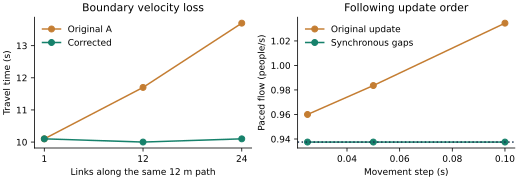
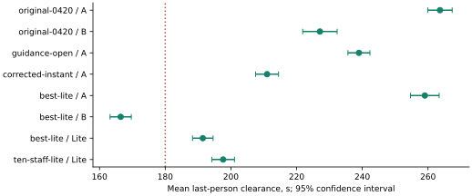
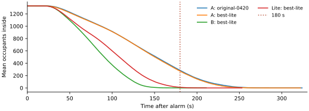

# A-Lite: model simplification and experimental audit

**Independent confirmation: A-Lite 191.4 s [188.3, 194.6]; the mean 180-second target was not achieved.** All forty A-Lite audiences cleared; six cleared by 180 s. The same guidance gives 259.0 s in A and 166.4 s in B. These are model-dependent predictions, not estimates to average together.

The reference is Mateus's 8 November 2026, 04:20:42 EST commit `3e4bcf0`. The previous source was saved before this extension. Original A remains available when optional switches are absent. Every new operational finalist has **no barriers**, retains 1,329 people and three wheelchair users, and uses unchanged geometry, gate rates, body-size/speed/response distributions and imperfect compliance. A-Lite deliberately simplifies group motion; that structural change is not an operational achievement.

The companion **MODEL_GUIDE.pdf** develops the full model ladder and shared mathematics. This report specifies A-Lite, audits mechanisms and reports verification and experiments. Historical panel-based winners remain in **RESULTS_AND_CHANGES.pdf**; they are not proposed egress installations.


## Movement mechanisms: evidence and simplification

| Mechanism | Classification and calibration | A-Lite treatment; information lost |
|---|---|---|
| 1,329 audience, three wheelchairs, three seating levels | Bailey-specific problem specification | Retain all people and sampled traits; no occupancy reduction |
| 268 nodes, 384 links, widths, slopes, exit connectivity | Bailey-specific reconstruction; many dimensions approximate | Retain every original link and distance; no contraction or new path |
| Accessibility, one-way links, closures | Bailey-specific requirements represented by graph attributes | Retain restrictions and discovery; a graph check does not establish installation compliance |
| Following gap and H=0.7 s | Empirically supported mechanism; generic coefficient [R4,R19] | Replace microscopic speed adjustment by the same representative rate J=v/(d+vH); lose individual gap trajectories |
| Acceleration relaxation, tau=0.5 s | Generic assumption, not calibrated to Bailey | Constant transit speed; no startup acceleration or braking waveform. Tested separately in A |
| Row cap 0.45, squeeze 0.20 m/s, 0.38 m obstruction lookahead | Literature supports row constraints; squeeze speed and detection distance generic [R18] | Seat-to-end distance / capped speed plus finite row storage and end service; lose seated obstruction and passing awareness cues |
| Random zipper priority, impatience bonus, lateral gap checks | Generic implementation of merging | FIFO among ready lane heads, shared downstream storage; lose body-level merge negotiation |
| Counterflow friction, lane changes, timed squeeze relief | Opposing-flow effects supported; exact rules generic | Directional capacity sharing and conservative slot exchanges; lose friction waves, body contacts and spontaneous lane formation |

## Behavioral mechanisms: evidence and simplification

| Mechanism | Classification and calibration | Decision and loss |
|---|---|---|
| Heterogeneous free speed, elderly mix and body size | Empirically supported heterogeneity; Bailey values assumed | Retain sampled attributes; radius affects reference capacity and exchange feasibility, not collision simulation |
| Lognormal recognition, response, preparation | Empirically supported distribution family; local parameters generic [R5] | Retain draws and state transitions. Their computational cost is small; removing them would change the problem |
| Neighbor awareness and phase-clock acceleration | Social response supported; exact coefficients generic | Retain for comparability; row passing no longer supplies an extra awareness cue |
| Group readiness, common destination and pace | Empirically supported effects; waiting/cohesion thresholds generic [R13,R14] | Retain readiness/90 s timeout, leader destination, slowest member's free pace; remove spatial lag stops and distance-triggered breakup |
| Persistent Gumbel tastes and familiar-exit preference | Empirically supported discrete-choice family [R3]; weights uncalibrated | Retain stable preferences, imperfect guidance acceptance and locally visible queues; no perfect shortest-path obedience |
| Urgency, trust, belief decay, event cooldown | Generic hypotheses; potentially unnecessary without calibration | Compare with existing on/off switch. Prefer the simpler state when performance and robustness support it |
| Route commitment and occasional reconsideration | Route revision observed, but exact thresholds generic [R7] | Retain existing routing for controlled movement comparisons; invalidate exhausted paths before inertia is applied |
| Manager hearing, activation and radio | Empirical mechanisms; Bailey hearing/reach values assumed | Retain imperfect hearing and activation, actual post coordinates and acoustic approximation; staff bodies are still absent |
| LEDs and pre-announcement | Supported interventions; separate detection and acceptance probabilities assumed [R8,R9] | Prefer fixed, visibility-limited public signs; retain incomplete adoption. No brightness or head-occlusion calibration |
| Adaptive staff/partial FCFS controller | Research-supported optimization family [R10]; global information in partial mode is a strong assumption | Compare static and zone control; partial forecasts tested in A, not asserted equivalent in Lite |
| Storage and service credit | Conservation is essential; 4.5 persons/m² and minimum link slots generic | Count every person in each original link, including transit and waiting. No 30 s capacity bypass |
| Falls, contact pressure, smoke tenability | Stress approximations or absent mechanisms | A-Lite rejects falls and separated-group stress; it is not an injury, fire or rescue simulator |

## Spatial queues and travel

For link e, let L be walking length, w width, l lane count and g the drawing-length/walking-length ratio. A-Lite retains A's lane count and all original graph nodes. Each directed lane has a FIFO queue. At entry, choose the least occupied available lane; opposing traffic uses A's allowed-lane count. Different lanes can proceed concurrently. Within a passage lane, a later entrant cannot leave before an earlier one. Row occupants join their selected row-end queue in predicted arrival order because their origins differ along the row.

$$
\begin{aligned}
v_{i,e}&=\min\!\left(v_i,\min_{j\in\operatorname{group}(i)}v_j\right)f_{\mathrm{env}}f_{\mathrm{stair}} \\
v_{i,\mathrm{row}}&=\min(v_{i,e},v_{\mathrm{row}}) \\
a_{i,e}&=\operatorname{entry}_{i,e}+\frac{L_e-s_{i,\mathrm{entry}}}{v_{i,e}}
\end{aligned}
\tag{L1}
$$

The group minimum is omitted for ungrouped people or the separately configured meet-outside scenario. Stair ascent/descent ratios and the outdoor factor remain individual. Nonzero response precedes entry. A-Lite does not apply A's extra spatial cohesion stop or break groups according to Euclidean separation. This is a structural simplification, not unchanged group mechanics.

An agent travels by a clock until a_i,e, then waits for service and downstream storage. Interpolated coordinates place it on its actual link for signs, staff reach and regional occupancy. Queue positions are drawn back along their lane. These coordinates do not establish collision-free body packing or accurate sub-link density.

$$
\begin{aligned}
J_e&=\frac{l_ev_{\mathrm{rep},e}}{2r_{\mathrm{mean}}+v_{\mathrm{rep},e}H} \\
S_e&=\max\!\left(l_e,\lfloor\rho_{\max}L_eg_ew_e\rfloor\right),\quad
S_{\mathrm{row}}=\max\!\left(1,\left\lfloor\frac{L_{\mathrm{row}}}{2r_{\mathrm{mean}}}\right\rfloor\right)
\end{aligned}
\tag{L2}
$$

The representative rate uses the inherited 1.2 m/s, H=0.7 s and mean radius 0.22 m; stairs use the inherited representative stair ratio. Actual travel still uses individual speeds. Door and stair entries also require their unchanged gate capacity C from the main guide. Multiple limits can bind, but no nominal physical rate is multiplied upward. Minimum lane slots mean S is not everywhere exactly floor(ρA), particularly on very short links.

## Service, counterflow and conservation

With N_e,+ and N_e,− people currently occupying a passage, divide its service between directions by their demand shares. Empty passages accumulate no new discharge credit. Each row end is a separate service resource: people leaving opposite ends generally drain different row portions, so row-end capacities are not halved simply because both ends are used.

$$
\begin{aligned}
\alpha_{e,d}&=\frac{N_{e,d}}{N_{e,+}+N_{e,-}}, & C_{e,d}&=\alpha_{e,d}J_e \\
b^*_{e,d}&=b_{e,d}+C_{e,d}\Delta t, & n_{e,d}&\le\lfloor b^*_{e,d}\rfloor \\
b'_{e,d}&=\min(1,b^*_{e,d}-n_{e,d})
\end{aligned}
\tag{L3}
$$

One initial person of credit is allowed per direction. Hence cumulative passage discharges in both directions cannot exceed the integrated shared rate plus two initial persons. Idle credit is bounded after admissions; no long idle period earns a burst. The same inherited gate token account enforces exterior and stair admission, with conservative service integration enabled.

$$
\begin{aligned}
N'_e&=N_e+\operatorname{admissions}_e-\operatorname{departures}_e,\quad0\le N'_e\le S_e \\
\text{admit }i\text{ to }e&\text{ only if open, accessible to }i\text{, and }N_e<S_e
\end{aligned}
\tag{L4}
$$

A reversal on the same link does not add occupancy. Two opposing queue heads may exchange slots at their common junction only when both have completed travel, both have discharge credit, any gate credits are available, and the two body diameters fit the narrower link. Remove both before adding either. Counts and service are conserved; this is not a permission to overfill storage after waiting. Unresolved queues remain failures. The rule represents passing in an aggregate queue model, not proven collision-free trajectories.

Finite-storage pedestrian networks are supported as a modelling family by Guo, Huang and Wong (2011) [L-R1]. Restricted queues can produce representational deadlocks, including ones that swapping customers resolves, as discussed by Palmer, Harper and Knight (2018) [L-R2]. Neither paper calibrates this particular Bailey hybrid or its exchange rule.

## Response, route choice and visibility

The original population's lognormal recognition/response/preparation draws, local social clocks and readiness waiting remain. The primary endpoint is still the last of all 1,329 people crossing an exterior boundary; assisted travel to street level is reported separately. Leaving a door and reaching the street are distinct route stages. An exhausted indoor route must be invalidated before selecting its continuation, otherwise a zero-length old path can defeat the route-inertia threshold.

$$
\begin{aligned}
c_{i,e}&=\operatorname{walk}_{i,e}+\operatorname{visibleQueueCost}_{i,e}+\operatorname{opposingCost}_{i,e}+\operatorname{ropeCost}_e \\
U_{i,g}&=-w_T\frac{T_{i,g}}{30}+w_FF_g+w_SS_{i,g}+3w_GG_{i,g}+w_II_{\mathrm{current}}+\varepsilon_{i,g} \\
\varepsilon_{i,g}&\sim\operatorname{Gumbel}(0,1)\quad\text{(once per person and exit)}
\end{aligned}
\tag{L5}
$$

These are the existing A equations, not a fresh parameter fit. Choice is restricted to known exits and accessible/open routes, with imperfect acceptance of staff, pre-announcement and signs. Persistent tastes mean the softmax formula describes the cross-sectional random-utility construction, not an independent redraw at every junction. Adaptive urgency/trust/memory can be switched off while preserving this simpler choice model.

Spatial signs retain floor, distance, facing and drawn wall/column occlusion. Manager reach is evaluated using the original graph and room approximation. A-Lite thus differs from B in its uncontracted spatial links, finite storage accounting for all transit, lane-level FIFO, row occupancy, queue location, and conservative opposing-slot exchanges. It is not B with a new label. It also retains more A behavior than a minimal queue network; the audit identifies which mechanisms still need calibration.

## Essential parameters and reproducible choice weights

The primary tone-alarm population uses independent standard-normal draws for speed, recognition, response and preparation; the repeated Z notation below denotes the appropriate draw, not a single shared variate. With age factor f=0.78 for the sampled 25% elderly share and f=1 otherwise, speed is clipped to [0.5,2.0] m/s; wheelchair speed is 0.8. Recognition and response have log-scale sigma 0.6. Preparation is a 50:50 mixture, preserving a short nonzero preparation phase even without belongings.

$$
\begin{aligned}
v_i&=\operatorname{clip}\!\left[f(1.2+0.25Z),0.5,2.0\right] \\
\tau_{\mathrm{rec}}&=6e^{0.6Z},\qquad\tau_{\mathrm{response}}=m_i e^{0.6Z} \\
m_i&=14L_{\mathrm{level}}\exp\!\left[0.04\min(d_{\mathrm{aisle}},15)+0.05\frac{d_{\mathrm{door}}}{10}-0.15I_{\mathrm{familiar}}\right] \\
\tau_{\mathrm{prepare}}&=\begin{cases}6e^{0.6Z},&\text{probability }0.5,\\1.5e^{0.3Z},&\text{otherwise.}\end{cases}
\end{aligned}
\tag{L6}
$$

L_level is 1 for orchestra/mezzanine and 1.1 for balcony. Recognition and response clocks advance at 1+1.5φ; preparation advances at 1. Here φ is nearby moving share plus half preparing/standing share. Additional awareness uses the implemented first-order probability 0.4φΔt. Staff activation is lognormal with median 10 s, sigma 0.5; hearing uses 1−exp(−0.35) each second within eligible reach. Acceptance remains 0.8 before adaptive trust, preassignment reach/adoption 0.6/0.7, and LED notice/adoption 0.9/0.7. These numerical choices are inherited assumptions.

| Type (population share) | T | Q | F | S | G | I | Replan |
|---|---|---|---|---|---|---|---|
| Shortest (0.20) | 2.4 | 1.2 | 0.3 | 0.3 | 1.0 | 0.8 | 0.8 |
| Habitual (0.35) | 0.6 | 0.3 | 2.8 | 0.5 | 0.8 | 1.5 | 0.15 |
| Follower (0.25) | 0.8 | 0.4 | 0.9 | 2.8 | 1.0 | 1.0 | 0.5 |
| Queue avoider (0.10) | 1.4 | 2.8 | 0.4 | 0.2 | 1.0 | 0.6 | 0.9 |
| Cooperative (0.05) | 1.0 | 0.8 | 1.0 | 1.0 | 1.6 | 1.2 | 0.3 |
| Impatient (0.05) | 2.2 | 0.8 | 0.5 | 0.5 | 0.6 | 0.6 | 0.7 |

T/Q/F/S/G/I weight time, queues, familiarity, social choice, guidance and inertia in (L5); Replan is the probability of reconsidering at an eligible junction. They are uncalibrated qualitative orderings, retained to isolate movement changes. Queue cost is (Q/T) times visible Q_e/C_e with inherited narrow-door aversion; no perceived cost is added to physical travel time. Route inertia requires improvement above max(8 s,15% of remaining cost).

Gate capacity is q×max(0.4,w−2b)×0.97×environment×urgency factor: q=1.3 for doors or 1.0 for stairs; b=0.15 or 0.09 m. Divided stairs apply boundary loss to each lane. The unchanged urgency factor is (1+0.15u)[1−0.45 max(0,(u×meanImpatience−0.35)/0.65)²], with u=0.6. All complete configurations and the original population generator are saved; none of these weights is fitted to the 180-second target.

## References specific to this extension

**[L-R1]** Guo, R.-Y., Huang, H.-J. & Wong, S.C. (2011). *Collection, spillback, and dissipation in pedestrian evacuation: A network-based method.* Transportation Research Part B 45, 490–506. [Author/institutional manuscript](https://sem.buaa.edu.cn/__local/C/C9/7C/FE43AA20309F2E9E62D9D53E007_57E48E48_2356F5.pdf), [DOI](https://doi.org/10.1016/j.trb.2010.09.009). Supports finite-storage spatial-flow modelling; its hexagonal-cell model is not this implementation.

**[L-R2]** Palmer, G.I., Harper, P.R. & Knight, V.A. (2018). *Modelling deadlock in open restricted queueing networks.* European Journal of Operational Research 266, 609–621. [Author manuscript](https://orca.cardiff.ac.uk/id/eprint/106314/1/1-s2.0-S0377221717309529-main.pdf), [DOI](https://doi.org/10.1016/j.ejor.2017.10.039). Queue deadlock and model interpretation; no claim of pedestrian passing calibration.

[R3–R19] refer to the numbered primary sources in `MODEL_GUIDE.md`, including Train; Seyfried; Johansson; Spearpoint and Xiang; theatre response/route-choice studies; group studies; and signage trials. Mechanism support and numerical calibration are separate claims throughout this report.

## Numerical artifacts and isolated verification

A carried displacement across a link boundary but discarded the carry from stored velocity. An empty 12 m path took 10.1 s as one link and 13.7 s as 24 links. Including admitted carry restores 10.0–10.1 s without increasing free speed. At most one boundary is traversed per step, so very short links remain a discretization limitation.

A's following law used the leader's already-updated position. A paced platoon discharged at 1.0345 persons/s at a 0.1 s step, versus the intended 0.9375. Start-of-step positions restore 0.9375 at steps 0.1, 0.05 and 0.025 s. Correcting this optimistic artifact can slow a whole-building run.

An exhausted indoor route could retain zero remaining cost after an exterior crossing and prevent continuation toward street safety. Invalidating a path that lacks the current node before applying route inertia fixes this demonstrated failure. It is mandatory in Lite and optional in A; it does not alter the exterior reporting boundary.



Tests cover corridor FIFO, row distance, sustained door/stair service, simultaneous merges, opposing slot exchange, parallel lanes, every-step storage and population conservation, identical audience draws, wheelchair accessibility and blocked-door discovery. Each Lite direction's cumulative discharge is bounded by integrated service plus one initial person. No timed storage overflow is permitted. These are implementation checks, not Bailey calibration; aggregate queue coordinates do not prove collision-free body trajectories.

The previous conservative gate integration preserves fractional service after admission. It is isolated from these new corrections. Queue costs and predicted waits affect route preferences; they are not added again to physical travel time. Original A permits multiple admissions at a junction: gaps, lanes and service constrain admission, not a blanket one-person-per-node rule.

## Progressive ablations in original A

Four common training audiences test individual mechanisms before combining them. The control uses the refined A guidance with historical panels removed. Invalid early Lite prototypes are excluded from all final-model conclusions.


| Variant | Class | Mean s | Difference s |
|---|---|---|---|
| Open-route control | Guidance | 236.4 | 0.0 |
| Boundary velocity | Numerical | 238.3 | 1.9 |
| Synchronous headway | Numerical | 245.0 | 8.6 |
| Both corrections | Numerical | 237.6 | 1.2 |
| Instant acceleration | Structural | 216.6 | -19.8 |
| Remove seated squeeze | Structural | 242.4 | 6.0 |
| FIFO merge priority | Structural | 237.4 | 1.0 |
| Group pace without spatial lag | Structural | 231.3 | -5.1 |
| Adaptive individual state on | Behavioral | 257.5 | 21.1 |
| Legacy fixed staff | Guidance + hearing | 245.4 | 9.0 |
| Combined structural switches | Structural | 216.0 | -20.4 |

Acceleration removal produced the strongest individual improvement in this screen. Removing seated squeeze or random merging did not improve mean time. Static legacy staff also changes the hearing/version model, so it does not isolate redirection. All numerical corrections together gave 238.5 s; adding instant acceleration gave 207.9 s; adding all structural switches gave 212.3 s. Interactions cannot be obtained by adding individual effects.

A new partial-controller guard forecasts opposing intended-path arrivals over 10 or 20 s, retaining the chained-FCFS predictor. Four-audience means were 248.2 and 235.8 s versus control 236.4 s. Global intended-route knowledge remains an inherited strong assumption. No clear transferable benefit justified selecting this controller.

## Guidance, visibility and operational search

The final per-lane FIFO model uses four common training audiences below. The first group shares the A-derived open-route plan. B-derived plans are separate candidates: cross-plan differences are not channel-only effects.


| Training configuration | Lite mean s | Incomplete |
|---|---|---|
| no-guidance | 298.6 | 0/4 |
| existing | 254.9 | 0/4 |
| staff | 236.4 | 0/4 |
| preassign | 259.4 | 0/4 |
| led | 290.2 | 0/4 |
| staff-led | 229.3 | 0/4 |
| combined | 228.0 | 0/4 |
| static-combined | 242.6 | 0/4 |
| group-consistent | 224.8 | 0/4 |
| visible-signs | 224.6 | 0/4 |
| B-visible | 195.4 | 0/4 |
| B-static | 193.9 | 0/4 |

Abstract LEDs know each original seat block. Spatial signs carry fixed public messages and require range, facing angle and optionally clear sight through walls/columns/panels. Their notice/adoption values 0.9/0.7 are Bailey assumptions, not a decomposition of a trial's combined 66% redirection outcome [R8,R9]. More information did not consistently shorten evacuation.

`staticPlan` keeps instructions fixed under congestion but retains acoustic reach, manager-specific hearing and closure overrides. Static acoustic and adaptive zone policies both gave 201.8 s; legacy fixed staff gave 193.9 s. Removing LEDs from the acoustic policy gave 193.1 s. The selected Lite policy therefore uses staff plus preassignment, no LED, no barrier, and adaptive individual state off. Imperfect instruction acceptance and persistent route preferences remain.

Coverage with 6, 10, 12 and 18 staff gave 211.1, 204.4, 195.6 and 188.6 s on four audiences. Extra staff are an explicit resource. Staff bodies and their own evacuation are absent from the inherited audience model; placements are graph-based candidates, not surveyed installations.

Three final-formulation coordinate searches each evaluated 77 block plans on four audiences. A visible-sign plan improved 193.9 to 187.9 s; a ten-staff/no-LED plan 193.1 to 185.4 s; an eighteen-staff plan 188.6 to 186.3 s. Every trial is retained. Twelve training audiences then selected the optimized no-LED plan with eighteen coverage posts, mean 189.1 s. The 44-block plan was frozen before independent evaluation. Search does not prove a global optimum.

## Independent confirmation and transfer

Training uses base seed 9001; forty fresh confirmation audiences use 20261109. The frozen configuration and timestamp are in `selection.json`. All failures remain. An unresolved audience makes the unconditional full-house mean unresolved. Median and p95 here describe last-person times across runs, not individual exit times.


| Configuration / model | Mean [95% CI], s | Median / p95, s | SD, s | ≤180 | Failures |
|---|---|---|---|---|---|
| original-0420 / A | 263.6 [259.9, 267.4] | 263.1 / 283.3 | 11.6 | 0/40 | 0 |
| original-0420 / B | 227.1 [221.8, 232.3] | 222.2 / 254.6 | 16.4 | 0/40 | 0 |
| guidance-open / A | 239.0 [235.6, 242.3] | 236.2 / 258.0 | 10.5 | 0/40 | 0 |
| numerically-corrected / A | Unresolved | — | — | 0/40 | 1 |
| corrected-instant / A | 211.0 [207.5, 214.5] | 209.9 / 227.3 | 10.9 | 0/40 | 0 |
| best-lite / A | 259.0 [254.7, 263.4] | 258.8 / 279.3 | 13.6 | 0/40 | 0 |
| best-lite / B | 166.4 [163.2, 169.7] | 165.9 / 177.6 | 10.1 | 38/40 | 0 |
| best-lite / Lite | 191.4 [188.3, 194.6] | 191.1 / 208.9 | 9.8 | 6/40 | 0 |
| ten-staff-lite / Lite | 197.6 [194.2, 201.1] | 198.2 / 215.4 | 10.8 | 0/40 | 0 |

Same-policy Lite minus A is **-67.6 s [-73.2, -62.0]**. This includes movement/group simplification and feedback on starts and choices, not just microscopic friction. Eighteen versus ten staff in Lite gives **-6.2 s [-10.9, -1.5]**. A-specific open-route guidance versus original A gives **-24.7 s [-29.2, -20.1]**.

Lite's 6/40 completion-within-180 fraction has Wilson interval [0.071, 0.291]; B's 38/40 has [0.835, 0.986]. Every complete A variant has zero passes. The Lite policy transfers poorly to A: 259.0 s versus 239.0 s for A-specific guidance. A model-specific winner is not a robust cross-model policy.

All-corrections A fails on seed 1902007568 with 36 people inside. Its 230.9 s mean over the other 39 audiences is completion-conditioned, not a successful full-house mean. The saved failure state shows stalled east orchestra aisles/rows with opposing destinations and two people not on a link. Fixing isolated numerical artifacts does not establish freedom from spatial gridlock; defaults remain unchanged.





## Last-person delays, queues and exit utilization

Read-only instrumentation records every movement step, state/link/route changes and gate series. Observer-detached replay produces identical per-person starts, exterior exits, safety times and route switches. Final-50 trajectories are gzip JSON with position, lane, velocity, group cap and blocking time. Constraint-active durations overlap and cannot be added as causal delays.

For seed 1294506412, historical refined A clears at 223.8 s. At 180 s, 241 remain: zero in seating/rows, 16 aisles, 89 corridors, 39 stairs and 97 other links; 50 are in exterior queues (a subset). The final 50 start at mean 41.7 s, experience 17.4 stop episodes each and a maximum continuous stop of 66.7 s. Following limits are active for mean 97.9 s and acceleration limits for 96.3 s. The late tail is downstream, not solely delayed seating response.

On the Lite-selected policy and that seed, A clears at 285.5 s versus Lite 192.5 s; first exits are 22.3 and 20.8 s. At 180 s A retains 280 people (zero rows, 13 aisles, 83 corridors, 77 stairs, 107 other), Lite nine. Final-50 mean starts are 39.2 and 24.3 s; membership differs, and local social feedback changes realized readiness without changing sampled response distributions. Stop episodes average 18.1 and 13.8; maxima are 65.6 and 98.2 s. Lite still has substantial queue waiting.


| Model | Peak regional density | Mean exposure | Mean largest gate queue | Mean inside at 180 |
|---|---|---|---|---|
| A | 4.4 | 29.1 | 116.4 | 272.0 |
| B | 5.3 | 16.1 | 33.2 | 0.1 |
| Lite | 4.2 | 18.2 | 39.1 | 10.3 |

Density is persons/m². Exposure is mean integrated excess above 2 persons/m², in persons·s/m² per occupant. Peak is the maximum over regions, times and runs. Gate queues count people targeting gates, not all internal waiting. Local density differs in resolution: sub-link in A, original whole links in Lite, contracted edges in B. Shared geographic regional density is more directly comparable. No density is interpreted as an injury threshold.


| Exit group | A mean people | Lite mean people | B mean people |
|---|---|---|---|
| FOYER | 528.0 | 532.7 | 547.2 |
| PORTICO_W | 285.5 | 286.8 | 286.8 |
| PORTICO_E | 290.0 | 288.9 | 284.0 |
| STAGE_W | 67.8 | 65.9 | 63.5 |
| STAGE_E | 56.5 | 54.9 | 53.5 |
| BAL_NW | 57.3 | 56.5 | 52.7 |
| BAL_NE | 43.8 | 43.5 | 41.5 |

Similar exit shares despite different clearance curves show that information about unused exits alone does not explain the discrepancy. Lite accumulates mean 50.6 s of queue waiting per person; the mean maximum individual wait is 152.8 s. These totals include outdoor continuation. Group readiness remains; additional spatial cohesion stops and distance-based breakup are removed.

Mean all-person street safety under the plan is 287.6 s in A and 235.3 s in Lite. B does not supply a finite assisted street-safety endpoint. All three include wheelchair users in building clearance.


| Trace model | Peak 5-s exterior admissions/s | Whole-run exterior utilization | Largest gate queue |
|---|---|---|---|
| A | 9.8 | 21.9% | 123 |
| Lite | 13.4 | 32.4% | 44 |

Utilization divides admissions by integrated nominal exterior capacity while anyone remains inside. Unused capacity includes periods without upstream supply and is not all avoidable waste. Peaks measure door admission, not the exterior-boundary crossing endpoint. Raw gate series retain the detailed resource-by-resource evidence.

## Blocked-door and physical sensitivities

F3 is closed from the start, using inherited discovery and manager communication. Twelve new audiences, base 20261110, are paired with an open-door case. Static staff retains closure overrides. This stress scenario is not an intervention for reaching 180.


| Model | Open mean s | Blocked mean s | Paired difference [95% CI] s | Incomplete |
|---|---|---|---|---|
| A | 262.1 | 271.3 | 9.2 [3.7, 14.7] | 0/12 |
| B | 165.0 | 170.2 | 5.2 [-7.0, 17.5] | 0/12 |
| Lite | 191.4 | 192.1 | 0.7 [-7.6, 8.9] | 0/12 |

The required six-cell physical sensitivity grid uses twelve common training audiences and the same open-route A-derived guidance. Headway changes assumed passage capacity; row speed changes travel. These are calibration hypotheses, not operational gains [R4,R18,R19].


| Headway / row speed case | A mean s | Lite mean s |
|---|---|---|
| H0.7-row0.45 | 235.6 | 223.8 |
| H0.6-row0.45 | 232.3 | 216.9 |
| H0.5-row0.45 | 233.8 | 213.5 |
| H0.7-row0.6 | 235.1 | 223.6 |
| H0.6-row0.6 | 230.9 | 217.4 |
| H0.5-row0.6 | 235.0 | 219.6 |

Under the selected Lite policy, H=0.7 s gives 189.1 s on twelve training audiences, H=0.6 gives 198.9 s and H=0.5 gives 192.1 s, with row speed unchanged. Rates alter queue information and subsequent routes, so full-building time need not improve monotonically. No tested alternative reaches 180; these results do not justify lowering congestion merely to force a pass.

## Time-step sensitivity and runtime

A three-audience check retains the frozen policy. Nominal service tests converge, while the full behavioral system can change ordering, event timing and subsequent random decisions as the step changes. Matching audience seeds therefore does not guarantee identical later choices.


| Model | Step 0.10: mean s | Step 0.05: mean s | Step 0.025: mean s |
|---|---|---|---|
| A | 264.9 | 261.9 | 273.6 |
| A-corrected | 221.5 | 231.2 | 228.8 |
| Lite | 181.8 | 192.6 | 196.2 |

The small Lite sample did not establish convergence. The frozen policy was therefore also evaluated at finer steps on the same forty independent confirmation audiences. This is a robustness check after selection, not optimization over step size.


| Step s | Lite mean s | 95% CI | Paired difference vs 0.10 s |
|---|---|---|---|
| 0.10 | 191.4 | [188.3, 194.6] | reference |
| 0.05 | 193.0 | [188.5, 197.5] | 1.5 [-3.6, 6.6] |
| 0.025 | 188.7 | [186.2, 191.2] | -2.7 [-5.8, 0.4] |

These results quantify whole-model sensitivity. A saturated-service unit test does not establish convergence of adaptive evacuation outcomes. A favorable discretization must not be promoted as an operational improvement.

Runtime is measured after the main jobs, in one process with one warm-up per model and three matched audiences in rotating model order. It includes construction and simulation, excluding serialization. Lite averages about 1.15 times faster than A here, a modest runtime benefit; B is about twice as fast as A. Shared routing and guidance still consume work. Contended exploratory worker timings are retained but not used for speedup claims.


| Model | Mean wall time ms | Median ms |
|---|---|---|
| A | 2258.7 | 2254.8 |
| B | 1124.9 | 1091.8 |
| Lite | 1958.9 | 1894.4 |

## Changes and reproduction

The earlier full suite passed 144 tests in 11 files. The final focused run passed 50 tests in three files, including a new blocked-door Lite regression and stronger every-step conservation assertions (145 total tests are now defined). Exact counts and build output are saved in `final-focused-tests.log` and `final-build.log`. Geometry and source hashes are in `verification.json`. All changes remain uncommitted.

| Component | Change and purpose |
|---|---|
| `LiteSimulation.ts`, `LiteMovement.ts` | Separate original-graph FIFO movement, strict storage, directional service, simpler group motion and density reporting |
| `Movement.ts`, `Routing.ts`, `Params.ts` | Optional numerical corrections and individual structural switches; original absent-flag behavior retained |
| `SimulationEngine.ts`, `MovementObserver.ts` | Optional movement factory and read-only diagnostic hooks; exact observer replay |
| `ManagerPolicy.ts`, `Guidance.ts` | Static acoustic staff policy and intended-counterflow forecast guard |
| Pool, optimizer and study scripts | A/B/Lite runs, complete configs, seeds, failures, source snapshots and final-50 trajectories |
| Movement/adaptive tests | Flow, storage, population, accessibility, closures, numerical counterexamples and guidance behavior |
| LaTeX pipeline | Editable sources, native mathematics, vector figures, cross-references and bibliography |

Large raw records are losslessly compressed on GitHub. Run `python3 scripts/restore-research-data.py` before using an analysis script that expects original JSON paths. Small runnable configurations and comparison CSVs remain uncompressed. The Python report builders read either format directly.

From `mateus-0420` with Node 22:

```
node --import tsx scripts/run-lite.ts --config results/lite-study/best-config.json --seed 1294506412 --out results/lite-study/reproduced.json
node --import tsx scripts/lite-study.ts --cases results/lite-study/confirmation-cases.json --out results/lite-study/reproduced-confirmation.json --seed 20261109 --runs 40 --workers 3
node --import tsx scripts/lite-convergence.ts
npm test
npm run build
python3 scripts/build-latex-docs.py --compile
python3 scripts/check-research-pdfs.py
```

The generated `latex` directory is self-contained: compile its `.tex` files using Tectonic or XeLaTeX. The first Tectonic run may fetch TeX packages. Generation requires Python/PyMuPDF; plots use Matplotlib. Fonts and vector equations are embedded. The study README identifies the retained final-model evidence; superseded prototypes are excluded from the published branch. Each final dataset includes configuration, seeds, source hash identifying an exact shared snapshot in `results/source-snapshots`. Every optimizer evaluation is retained.

## Recommendation and answers

**Is A overcomplicated relative to evidence?** Several microscopic and adaptive psychological rules use generic coefficients. More detail does not establish more realism. A remains valuable for exposing lane ordering, seated obstruction and spatial group interactions that queue models omit.

**Which restrictions are unnecessary?** Discarded admitted carry and invalid exhausted routes are demonstrated implementation artifacts. Acceleration is the strongest tested structural restriction; removing it is not a physical correction. Headway is a meaningful capacity mechanism, and its old discretization was optimistic. Removing seat squeezing or merge randomness did not consistently help. Group behavior cannot simply be deleted to claim success.

**Why is B faster?** It contracts walking links, aggregates seatway/lane travel, omits detailed spatial cohesion stops and retains optimistic receiving-storage/30-second relief. It still has heterogeneous response, preferences and group pace. Similar exit shares with very different clearance show that flow representation matters. Its under-180 result does not validate real Bailey performance.

**Is Lite more credible?** It is verified for stated population, storage and service invariants, not empirically validated. It retains the original spatial links and strict storage absent in B while omitting body-level interactions in A. This makes assumptions easier to inspect, not automatically more accurate. Queue coordinates cannot support contact-force, crush-injury or detailed body-level density claims.

**Which model should be primary?** Use A-Lite as the transparent operational-comparison model, original A as a required structural stress comparison, and B as an aggregate cross-check. Report time-step sensitivity and calibration uncertainty alongside results. The chosen Lite policy's poor transfer to A prevents calling it a robust building-wide solution. Corrected instant-acceleration A remains a structural sensitivity, not a validated replacement.

**Was 180 achieved defensibly?** Original A and Lite did not meet the independent mean target. The strongest complete new spatial-A alternative is 211.0 s after optional numerical fixes plus simplified acceleration. New open-route guidance alone gives 239.0 s. The historical 231.2 s A result used panels and is not a current installation recommendation. Lite gives 191.4 s at its nominal step; B gives 166.4 s under the same policy. No occupancy, response, compliance, geometry or physical rate was secretly changed. Finite search does not prove no better policy exists.

**What would improve evidence for judges?** Survey usable widths and visibility; measure seatway, aisle, stair and door trajectories/flow; observe group separation, response and actual staff/sign reach; compare with a suitable drill. These data could choose between model families and justify coefficients. Literature supports mechanisms, not venue-specific numerical validation. The defensible contribution is a transparent, reproducible comparison with explicit limits.
