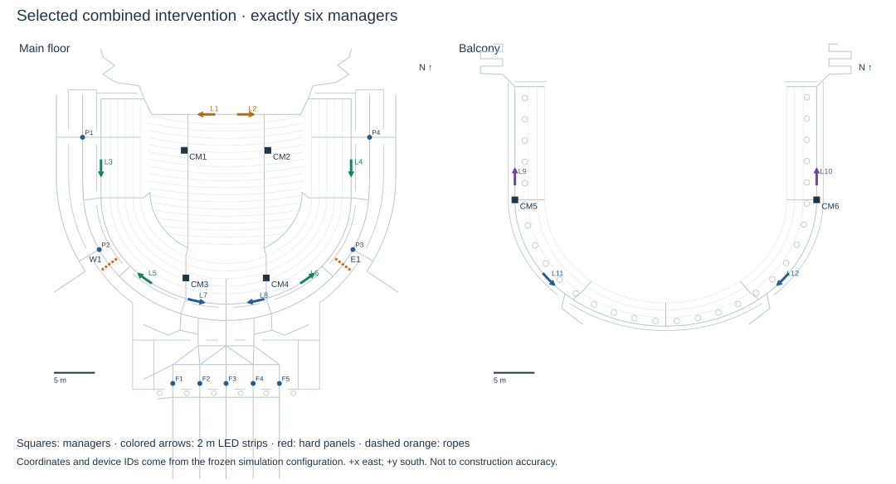
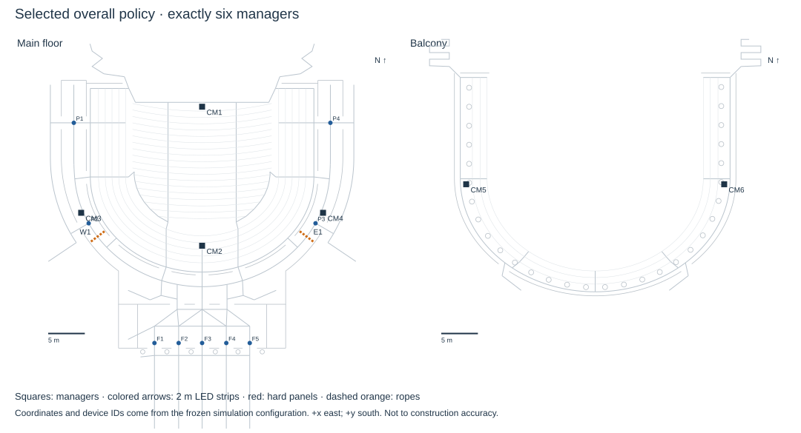

# Historical A-Lite route study

This completed study predates A-Lite+. Its model recommendation and intervention semantics are historical; the current primary model and all-five-question analysis are in the [A-Lite+ report](../../docs/research-180/RESULTS_AND_CHANGES.pdf). Reproducing this archive does not overwrite the current manuscript or executive summary.

## Latest result and recommended primary model

At the original 0.1 s step, A-Lite gives 186.9 s overall and 188.8 s with both devices. At the prespecified finest step (0.0125 s), the same plans give 186.8 s [182.6, 191.1] and 190.4 s respectively, on the same 60 fresh audiences. The finest-step study does not demonstrate a mean interval below 180 s. These are model predictions, not Bailey drill calibration. **A-Lite is recommended for comparative planning** because it retains the original walkway graph, individual behavior, finite storage and physical guidance locations. B remains a coarser comparison, A a spatial-mechanism check and C a flow benchmark. The choice of primary model precedes the new holdout; a faster B result does not establish the A-Lite target.

## What changed in this continuation

Actual full-run audits now check that people use their own initial seatway, then only connected non-row walkways, open links and accessible routes. They include hard panels, ropes and unexpected closure. No seat-back crossing or new walkway was added. A-Lite's internal queue positions remain approximate and may relocate backward on the same link; they are not collision-resolved trajectories. Live animation now follows the walkway polyline through bends and junctions, fixing the straight-chord drawing artifact without changing simulation results.

A-Lite is named in the app header, has a dedicated tab and shows walkway lines by default. The study tab exposes exact single-audience and whole-batch replay controls. Use port 5180 for this checkout. The model guide adds a single-model recommendation, question-by-question scope, decision-engine explanation and an explicit calibration evidence ledger with a proposed fitting objective. None of the models is claimed empirically calibrated to Bailey.

The additional search changes only permitted instructions and placements. Population, widths, headway, speeds, response, group waiting, capacity and compliance remain unchanged within each model. Spatial LED messages remain fixed public messages; changing the seat-block plan does not give a strip personalized knowledge. Staff remain exactly six. The documented conservative service correction remains enabled. No congestion coefficient was reduced to make the target pass.

## Search, selection and independent confirmation

Coordinate descent evaluated **217 distinct 44-block plans** on eight common training audiences (base 62006), accepting improvements above 0.75 s for up to three sweeps. Its final training mean was **180.4 s**. The resulting instructions were screened with all 84 existing staff/LED/barrier arrangements on those same training audiences. A prespecified shortlist of 8 configurations, including the previous combined plan, was compared on 24 additional training audiences (62007). The complete configuration with both devices and the lowest mean was frozen before 60 fresh confirmation audiences (62106).

The frozen choice is `route-coverage-decision-rope1`, with validation mean 190.2 s. The follow-up includes 20 paired audiences (62206) for ablations and closure/visibility diagnostics, and 20 per separate ordinary/lecture scenario (62406). In total **3,540 new experiment replications** were run, excluding passive-audit and browser verification replays. Search results are not independent evidence of success; the confirmation table is.

A second role was prespecified before confirmation: select the lowest complete validation mean irrespective of device presence. This chose `route-decision-none-rope1` at 189.6 s on validation, with LEDs off and 2 barrier links. The model must represent LEDs, but a beneficial LED effect is not imposed as a premise. Both policies are reported; neither was selected by its holdout score. If the two roles choose the same configuration, their repeat replays are not additional independent audiences.

| Configuration | Model | Runs | Mean [95% CI], s | At or below 180 | Unresolved |
|---|---|---|---|---|---|
| overall-selected | Lite | 60 | 186.9 [182.9, 190.9] | 18/60 | 0 |
| overall-selected | A | 60 | 212.4 [208.9, 215.9] | 0/60 | 0 |
| overall-selected | B | 60 | 183.4 [180.3, 186.5] | 27/60 | 0 |
| selected | Lite | 60 | 188.8 [184.4, 193.2] | 22/60 | 0 |
| selected | A | 60 | 214.9 [210.7, 219.0] | 0/60 | 0 |
| selected | B | 60 | 179.5 [175.4, 183.5] | 37/60 | 0 |
| previous-combined | Lite | 60 | 198.7 [194.6, 202.8] | 5/60 | 0 |

The paired A-Lite difference, selected minus previous combined policy, is **-9.84 [-15.69, -3.99] s**. Negative values mean faster. Both use the same 60 audiences. Full-house failures invalidate an unconditional finite mean; nobody is silently dropped. The success fraction concerns the last person's building crossing, not mean individual travel time.

## Numerical resolution: the time step is not a physical congestion coefficient

A six-audience pilot found substantial individual-run changes when the step was reduced. Its broad paired interval did not establish a systematic gain. We therefore froze a resolution protocol before the larger test: retain both operational plans and the same 60 confirmation audiences; report every resolution; use the finest tested 0.0125 s for the refined prediction, irrespective of whether it is faster. No physical speed, headway, capacity, response distribution or compliance changed. The original 0.1 s results above remain visible.

Smaller steps reduce rounding of link arrivals, admissions and state updates. In this nonlinear stochastic simulation they can also change later route and hearing histories. Individual trajectories need not converge monotonically. Mean confidence intervals quantify audience sampling at each resolution; they do not cover discretization or structural uncertainty. A fine-step mean below 180, if obtained, is still not an empirically calibrated Bailey guarantee.

| Configuration | Model | Runs | Mean [95% CI], s | At or below 180 | Unresolved |
|---|---|---|---|---|---|
| overall-dt0.05 | Lite | 60 | 187.4 [183.2, 191.6] | 19/60 | 0 |
| overall-dt0.025 | Lite | 60 | 185.8 [182.8, 188.7] | 19/60 | 0 |
| overall-dt0.0125 | Lite | 60 | 186.8 [182.6, 191.1] | 20/60 | 0 |
| combined-dt0.025 | Lite | 60 | 189.8 [185.3, 194.4] | 22/60 | 0 |
| combined-dt0.0125 | Lite | 60 | 190.4 [185.8, 195.1] | 17/60 | 0 |

| Paired resolution change, same policy and audience | Difference [95% CI], s |
|---|---|
| Overall: 0.05 minus 0.1 | 0.55 [-5.28, 6.38] |
| Overall: 0.025 minus 0.1 | -1.09 [-5.12, 2.94] |
| Overall: 0.0125 minus 0.025 | 1.06 [-3.47, 5.59] |
| Combined: 0.0125 minus 0.025 | 0.62 [-2.98, 4.21] |

The refined configurations are separate files (`refined-overall-config.json` and `refined-combined-config.json`). The selected policies and all original-step records are retained. Resolution comparison does not establish a universal convergence bound. Blockage and device ablations below use the original 0.1 s step and must not be subtracted from a fine-step time to claim a device benefit.

## Actual devices and instructions

Selected staff placement: **coverage**, six posts. Barrier links: **CO_7, CO_20**, types: **soft-rope, soft-rope**. LEDs: twelve 2 m strips, **24 m total**, with finite range and occlusion. Ropes add the unchanged assumed 15 perceived seconds to crossing cost; panels close their slot. Neither increases capacity. A rope is deliberately crossable and is not equivalent to a hard restriction. Unknown exit closures are learned through the existing mechanism, not revealed by the optimizer at run time.

| Changed seat block | Previous instruction | Selected instruction |
|---|---|---|
| ORCH_FRONT_E:E:F | STAGE_E | PORTICO_E |
| ORCH_C_FRONT:W:B | FOYER | PORTICO_W |
| ORCH_C_FRONT:E:B | FOYER | STAGE_E |
| ORCH_C_BACK:E:B | FOYER | STAGE_E |
| MEZZ_C_W:W:B | FOYER | STAGE_W |
| MEZZ_C_E:E:B | FOYER | STAGE_E |
| BAL_W_N:W:B | BAL_NW | FOYER |
| BAL_C_E:E:B | FOYER | BAL_NE |

The plan is published as `results/route-study/selected-config.json`. Block names identify the existing section, side and front/back band. Unchanged blocks retain their original instruction. Instructions are heard and accepted imperfectly; the optimizer cannot assign actual exit usage directly. The plotted arrangement is a reconstruction, not a construction drawing.

## Ablations, blocked exits and visibility

| Configuration | Model | Runs | Mean [95% CI], s | At or below 180 | Unresolved |
|---|---|---|---|---|---|
| selected | Lite | 20 | 189.6 [180.4, 198.9] | 7/20 | 0 |
| no-led | Lite | 20 | 187.0 [183.3, 190.7] | 3/20 | 0 |
| no-barriers | Lite | 20 | 213.3 [204.2, 222.4] | 0/20 | 0 |
| neither | Lite | 20 | 206.7 [198.4, 215.0] | 0/20 | 0 |
| blocked-F3 | Lite | 20 | 187.6 [180.1, 195.1] | 8/20 | 0 |
| blocked-FC2 | Lite | 20 | 203.1 [196.7, 209.5] | 0/20 | 0 |
| blocked-D3 | Lite | 20 | 187.7 [181.3, 194.1] | 5/20 | 0 |
| short-visibility | Lite | 20 | 188.6 [181.9, 195.3] | 7/20 | 0 |
| group-message | Lite | 20 | 188.8 [183.2, 194.4] | 3/20 | 0 |

| Paired change (A-Lite) | Mean difference [95% CI], s |
|---|---|
| Add LEDs, with selected barriers | 2.64 [-5.13, 10.40] |
| Add barriers, with selected LEDs | -23.70 [-36.57, -10.83] |
| Add both devices | -17.10 [-26.41, -7.79] |
| F3 unavailable vs open | -1.98 [-8.06, 4.10] |
| FC2 unavailable vs open | 13.47 [2.97, 23.97] |
| D3 unavailable vs open | -1.93 [-11.23, 7.37] |

These are diagnostics of the frozen plan, not another selection round. A closure can change route choice enough to reduce this model's clearance time; it does not add capacity or justify closing an exit. Low-level signs keep fixed messages and do not magically detect the closure. Group-consistent messages change only advice, not group movement or readiness. Results remain conditional on incomplete calibration of hearing, visibility and preferences.

## Other original questions and calibration limits

| Configuration | Model | Runs | Mean [95% CI], s | At or below 180 | Unresolved |
|---|---|---|---|---|---|
| q1-ordinary | Lite | 20 | 357.4 [348.9, 365.9] | 0/20 | 0 |
| q3-lecture | Lite | 20 | 222.3 [207.5, 237.2] | 0/20 | 0 |

The ordinary-departure and lecture presets use separate inherited behavioral assumptions and zero managers; this is permitted by their distinct questions. Neither result substitutes for the six-manager concert. The lecture preset has familiar students and different response/luggage inputs; these are unvalidated scenario hypotheses. Q5 requires actual installation, staffing and training costs, which are not in the repository.

Research justifies testing limited mechanisms; it does not identify Bailey's headway, response tails, group behavior or sign acceptance. Geometry, per-door cumulative exit counts, seatway/aisle trajectories, message reach and start-time observations would be needed for empirical calibration, followed by independent validation. Model Guide Sections 22–23 state the scope and data requirements. The 180-second requirement was never used as a fictitious calibration measurement.

Reproduce the study with `scripts/route-followup.ts` after `scripts/optimise-plan.ts`, using the saved configuration and seed arguments in the study README. Raw experiment records are losslessly compressed, configurations and summaries remain readable, and source snapshots record the implementation. Verification findings and exact replay results accompany the archived data.
